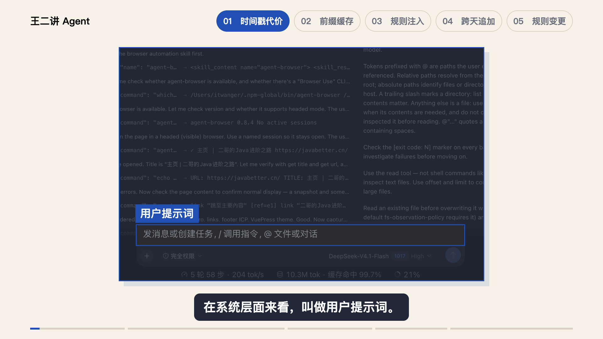
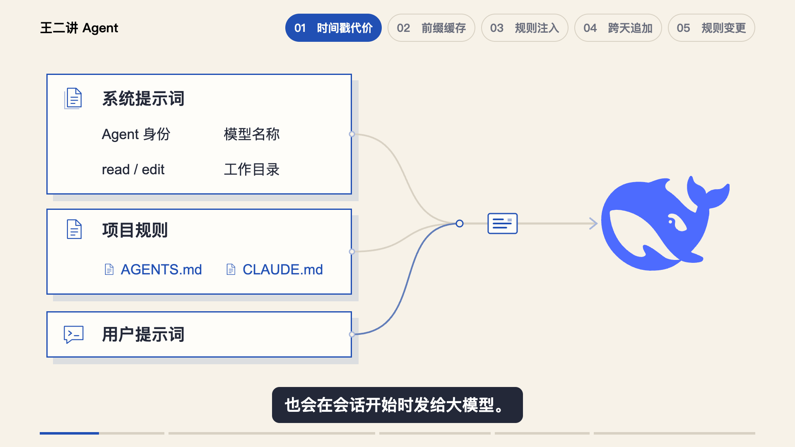
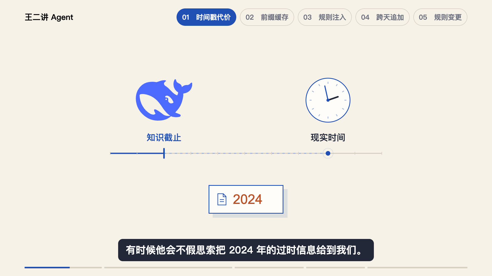

# 已认可的第一章视觉参考

2026-10-28，用户明确表示：“目前的第一章我就很满意了。”本样例对应《为什么不能在 System Prompt 里放时间戳？》的 `Chapter1Preview`，64 秒，1920×1080、30fps。验收范围是第一章 Studio 预览，不表示整片导出或其余章节已完成。

通用规则集中在 [用户偏好](USER_PREFERENCES.md)，这里保留实际成帧与实现入口。同类镜头先理解内容与动作的关系，再按新稿布局；不照搬本期品牌、对象数量、坐标或时长。

## 真实界面直接标注

在原始 Harness 截图上框选输入区、淡化其他区域，直接贴“用户提示词”标签；随后轨迹页签和系统提示词原文沿用相同表达。截图居中，撤去重复的右侧说明卡。

实现：[Chapter1.tsx 的 TraceOpening](../../../../docs/src/ai/script/why-not-timestamp-in-system-prompt/remotion/src/Chapter1.tsx)。记录：[opening-spotlight-review.json](../../../../docs/src/ai/script/why-not-timestamp-in-system-prompt/preview/chapter1/opening-spotlight-review.json)。

## 分组与连续发包

系统提示词、项目规则、用户提示词各有整体外框，统一边界，组内保持 40px 标题、34px 标签。四项系统内容随口播点亮，再发出载荷片段；接着两个规则文件，最后用户提示词，沿同一通道汇合并到达官方鲸鱼标志。省去与本段教学无关的协议和等待标签。

实现：[HttpRequestScene.tsx](../../../../docs/src/ai/script/why-not-timestamp-in-system-prompt/remotion/src/HttpRequestScene.tsx)。记录：[review.json](../../../../docs/src/ai/script/why-not-timestamp-in-system-prompt/preview/http-context/review.json)。这些片段表示上下文的组成与顺序，不是三次 API 调用或真实网络分包记录。

## 平衡构图与明确的镜头边界

模型与时钟等距分布在画布中心两侧，知识截止标记保持固定，时钟继续转动，旧信息送到中央。这个镜头只承接知识截止和旧信息一句，下一句转入原稿插图。“2024”是稿子里的旧信息示例，不是具体模型知识截止日期的实测结论。

## 沿原稿插图推进机制

同一张原图从全貌开始，依次突出规则文件、01/02 秒数、变化块、缓存失效与后续重算；使用遮罩、高亮描边和沿原箭头移动的标记，不替换原图文字、不拆成多套自制卡片。所有关联对象保留在同一画面中。

以上两段实现：[TimeAwareness.tsx](../../../../docs/src/ai/script/why-not-timestamp-in-system-prompt/remotion/src/TimeAwareness.tsx)。记录：[time-awareness-review.json](../../../../docs/src/ai/script/why-not-timestamp-in-system-prompt/preview/chapter1/time-awareness-review.json)。费用句沿原图“后续工具与历史需重算”承接，不添加虚构金额或实测账单。

四张图复制自用户认可版本的渲染静帧，未改动画面。静帧用于核对布局；动作节奏请结合源码与 [OUTLINE.md](../../../../docs/src/ai/script/why-not-timestamp-in-system-prompt/OUTLINE.md) 查看，不以一张静帧替代完整动画审阅。
