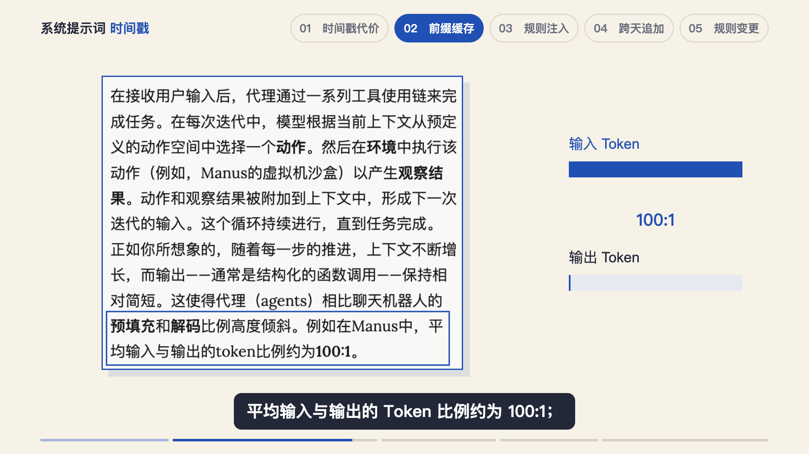
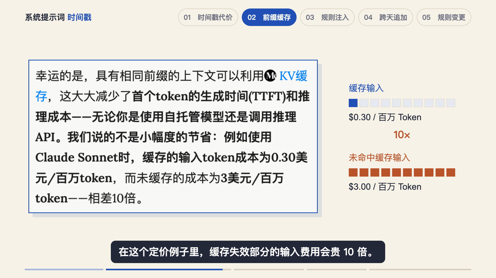

# 已认可的第二章视觉参考

2026-10-28，用户在最终截图可读性调整后回复“OK”，并要求沉淀第二章经验。本样例对应《为什么不能在 System Prompt 里放时间戳？》的 `Chapter2Preview`，3060 帧、102 秒，1920×1080、30fps。验收范围是第二章 Studio 预览。

通用取舍见[用户偏好](USER_PREFERENCES.md)，这里保留成帧与实现入口。不要把本期数字、网页宽度、对象数量和坐标固定到所有视频。

## 原文先框选，右侧再展开数据

原文内先框出含“例如在 Manus 中、平均、100:1”的完整表述，再在右侧展开输入与输出比例。没有另加网站、作者、日期等出处行。“不加出处行”不等于省略真实证据。

相邻定价段落继续使用同一张真实页面截图，镜头向下移并适度放大，右侧切为上下两组价格，标签、色块与价格对齐。

官网窄屏视窗让文字自然重排，再以足够分辨率采集，没有改写原文或重绘报告。取景利用纵向空间，边框避开文字笔画。这个版本的原文有效字号约 36–47px，只是本例结果，不要求其他截图固定为此值。

实现：[Chapter2.tsx 的 TokenRatio 与 Manus](../../../../docs/src/ai/script/why-not-timestamp-in-system-prompt/remotion/src/Chapter2.tsx)。采集：[manus-readable-capture.json](../../../../docs/src/ai/script/why-not-timestamp-in-system-prompt/assets/references/manus-readable-capture.json)。

## 用变化表达提问与原理

提问镜头没有使用两个说明框加问号：时间戳从 01 变为 02，新数据沿分支前进，无法连接旧缓存路径；旧缓存仍然可见。随后 A/B 选项按口播出现。块哈希与树索引分别示意，通过相同数据匹配变色和共享路径表达关系，删去画面上的解释性短句。

实现：同一文件的 `CacheQuestion`、`Methods`、`Matching`。动画时点来自强制对齐，成帧不能代替动作审阅。

## 本期事实修正与主题

用户选择删去没有原文依据的 1:1，只重配受影响的第 12 段；100:1 保留原文“Manus 的平均比例”范围，10 倍保留历史输入单价例子的范围。具体事实存在项目来源记录中，不作为别的视频的通用结论。

左上使用用户指定的“系统提示词 时间戳”，前半深色、后半蓝色，各章共用 [topic.tsx](../../../../docs/src/ai/script/why-not-timestamp-in-system-prompt/remotion/src/topic.tsx)。不要根据字段名 `brand` 自行换成栏目名。

完整审片与通过记录：[review.json](../../../../docs/src/ai/script/why-not-timestamp-in-system-prompt/preview/chapter2/review.json)。两张图片复制自最终认可版本的渲染静帧，未修改图片内容。
