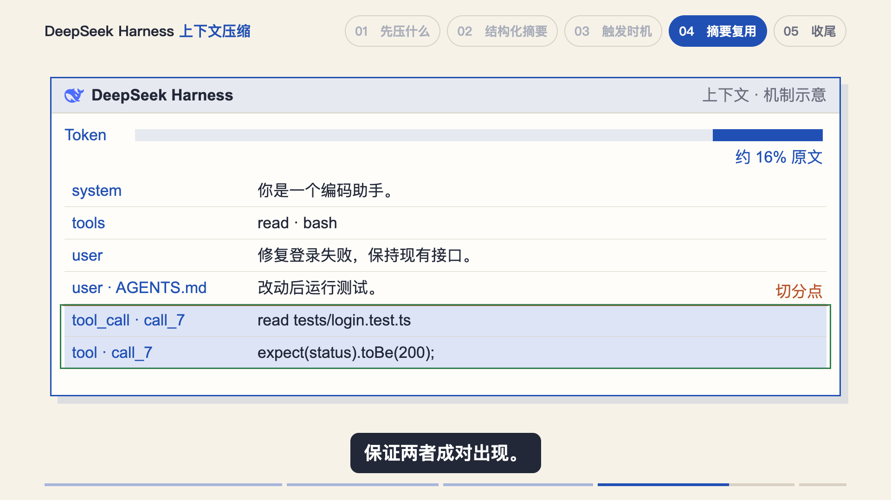
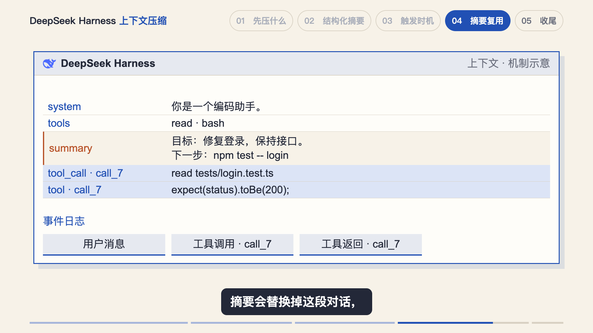
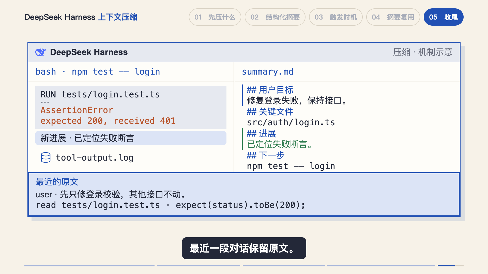

# 已认可的上下文压缩视觉参考

2026-10-30，用户逐章审阅《DeepSeek Harness 上下文压缩》，在第五章后明确表示“所有的优化都很到位”，并要求整理进 Skill。认可范围为五章 Studio 预览，不表示已导出、提交或发布。

通用判断见[场景构思](USER_PREFERENCES.md#场景构思)、[版式](USER_PREFERENCES.md#版式)与[音画对齐](AV_SYNC.md)。本页保留成帧与实现入口；不要固定复用本期品牌、示例任务、Token 常量、坐标和镜头时长。

## 先选择内容载体

| 内容 | 本期已认可的处理 | 实现入口 |
| --- | --- | --- |
| 上下文提问、工具输出占体积 | 完整工作区中展示任务、read 代码、bash 命令与具体报错；提问之后再进入选项 | [HarnessContextWindow.tsx](../../../../docs/src/ai/script/agent-memory-compaction-methods/remotion/src/HarnessContextWindow.tsx) |
| 一段话摘要漏信息、递归概括 | 在同一会话和摘要编辑区，让路径、报错、用户纠正丢失，或具体摘要被含糊短句覆盖 | [SummaryWorkspace.tsx](../../../../docs/src/ai/script/agent-memory-compaction-methods/remotion/src/SummaryWorkspace.tsx) |
| 阈值、工具输出裁剪和重估 | 已有源码节选建立依据；同尺度容量标尺演扣除与取小，具体日志中段收起后再重估 | [PressureScenes.tsx](../../../../docs/src/ai/script/agent-memory-compaction-methods/remotion/src/PressureScenes.tsx) |
| 前缀缓存、切分、替换、规则重注入 | 固定请求与缓存区；切分点前移；摘要替换选中历史；磁盘文件和上下文副本分区 | [CacheWorkspace.tsx](../../../../docs/src/ai/script/agent-memory-compaction-methods/remotion/src/CacheWorkspace.tsx) |
| 四步总结 | 同一工作区连续完成日志裁剪落盘、模板摘要填入、新进展合并和最近原文保留 | [RecapWorkspace.tsx](../../../../docs/src/ai/script/agent-memory-compaction-methods/remotion/src/RecapWorkspace.tsx) |

以上工作区均是教学机制示意。任务、路径和测试日志是示例内容；`summary.md`、`tool-output.log` 是教学视图与文件名，不代表真实产品的存储约定。机制依据与示例边界保存在项目 `assets/references/compaction-sources.json` 和各章 `*-scene-sources.json`。

## 切分和替换都要保留正确关系

切分点原本落在工具调用和返回之间，向前移动到完整配对之前。调用和返回使用同一标识，边界移动后仍能看出两者关联。

摘要替换历史后，这一对调用和返回仍然完整。底部日志保留原条目，再追加摘要事件；没有因为压缩而把“只追加”的日志画成删除。规则重注入则保留左侧磁盘文件，只改变右侧上下文副本。

本轮修正过的错误是：切分镜头保留了完整配对，替换镜头却只剩工具返回。因此不能仅凭切分帧正确，就推断后续结果也正确。

## 总结直接演四个动作

日志保留头尾，中段连续收起，文件副本落到磁盘对象；摘要按模板填入，新进展更新进展行，目标、路径和下一步保持。最近原文从头到尾逐字不变，最后才突出其范围。取消四张“图标＋总结短句”卡，仍然保留片尾头像与点赞关注。

合并运动中去掉了重复移动文字，改用移动选区和目标行更新，避免源文本与目标文本挤在一起。布局用足主体区，含阴影下沿距字幕约 63px；这只是本期测得的结果，通用原则是按实际导航、字幕和运动范围留出阅读间距。

## 原图、时间轴与验收入口

原稿五张配图保持原样、等比放入项目可用区域；说明列退场后回收空间。原图圈选通常只保留当前项，截图取景保留完整相关代码行与因果关系。具体镜头映射见 [OUTLINE.md](../../../../docs/src/ai/script/agent-memory-compaction-methods/OUTLINE.md)。

局部重配第32段后，后续章使用新时间轴；第四章最终登阶使用场景局部帧，避免章节后半段挂载时直接显示终态。用户未要求改动的其余口播和音频保持。

审片记录：[第三章](../../../../docs/src/ai/script/agent-memory-compaction-methods/preview/chapter3/review.json)、[第四章](../../../../docs/src/ai/script/agent-memory-compaction-methods/preview/chapter4/review.json)、[第五章](../../../../docs/src/ai/script/agent-memory-compaction-methods/preview/chapter5/review.json)。检查覆盖起音帧、密集状态、运动中段和结果；Studio 播放检查后关闭本次临时自动化浏览器会话，不关闭用户审片所需的 Studio。

三张图均原样复制自认可版本的静帧，依次来自 `preview/chapter4/adjust-1660.png`、`preview/chapter4/replace-1810.png`、`preview/chapter5/recent-404.png`，未改写图片内容。
