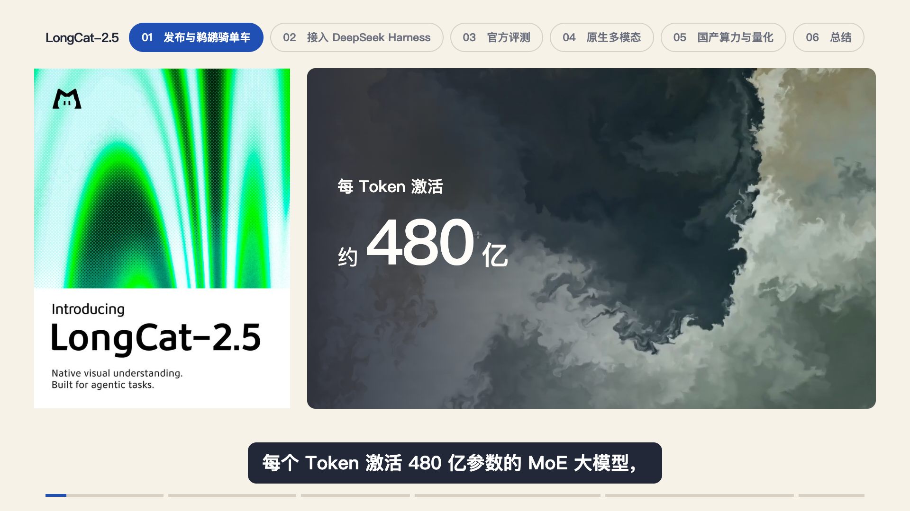
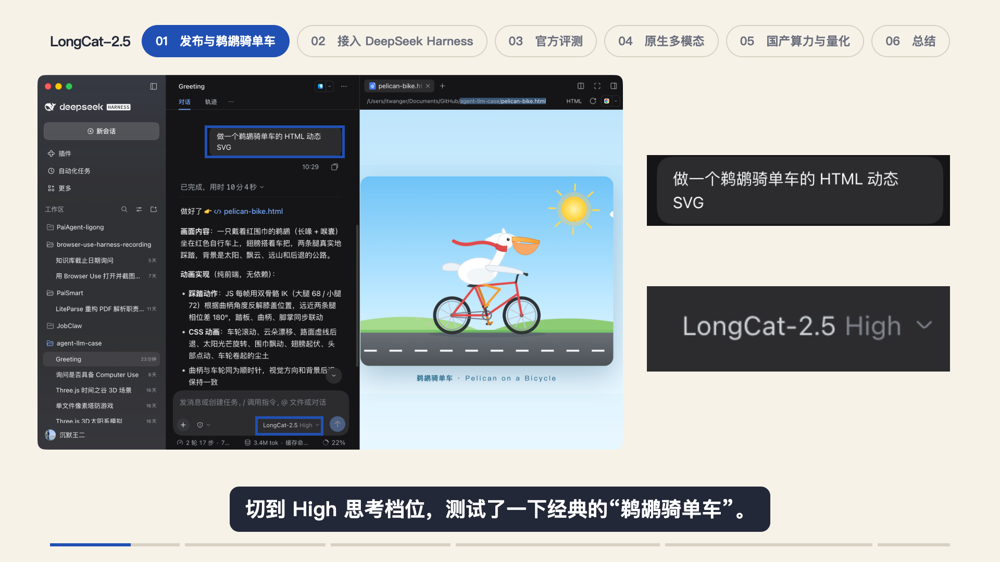

# LongCat-2.5 第一章：发布素材、录屏与音效

2026-11-03，用户在多轮审片后表示“整体已经很棒了”，要求将经验纳入 Skill。本例是《美团 LongCat-2.5 正式版发布》的第一章 Studio 预览，约 40 秒，1920×1080、30fps；不代表后续章节或整片导出已完成。

通用取舍已并入 [用户偏好](USER_PREFERENCES.md)。这里保留可核对的画面和实现入口；不把本例的尺寸、帧号、模型与配色素材当作其他视频的固定模板。

## 海报让位，动态画面进入

最初的“长段公告截图 → 数字排 → 第二张公告截图”被否定：上下宽度不一致、重复文字多，开场像阅读材料。改为官方发布海报建立身份，官方水墨演示承接动态；竖版海报先居中，再移到左侧，水墨从右侧进入，两者等高并排。海报持续保留，避免切走后产品身份消失。

本例海报 540×720、水墨视窗 1200×720，间隔 36px；海报在第 72–100 帧左移，水墨在第 82–108 帧进入，转场音落在第 82 帧。规格按真实口播依次突出 1.6 万亿、约 480 亿、1M，只保留当前项。数字讲完撤去，水墨继续运动，随后转入评测图。原口播与字幕未改。

水墨素材为官方演示，原视频 1660×1080、30fps；使用等比视窗裁去控制面板，未拉伸、改色或重绘。动态演示不是训练硬件证据；参数与训练说法仍需对应官方来源。原素材、来源、裁取区域和哈希见[素材记录](../../../../docs/src/ai/script/longcat-2-5/assets/references/official-opening-media.json)。

## 高清全貌与同帧放大镜

低清 GIF 放大后细节破碎。用户授权重新录制，使用原 HTML 的临时宽屏副本，扩展背景与视口，不改对象比例和运动逻辑，得到 2560×1440、30fps 素材。

底图与镜内共享同一素材、时间点与播放速度；圆镜按口播跟随太阳、前轮、踏板、喉囊和围巾，连续切换不重挂载、不循环。镜内放大 1.65 倍仍有原生像素余量。镜圈只留一层蓝色，讲整体时撤去。临时取景与录制依据见[录屏记录](../../../../docs/src/ai/script/longcat-2-5/assets/references/wide-capture.json)。

## 所有同类框选统一为纯色

用户先指出放大镜的白边加蓝边，随后指出 Harness 提示词与 High 档位也有同类问题。因此检查了本章所有截图、评测列和放大镜，一并去掉白色外圈。真实界面的圆角外不再叠直角装饰框或偏移阴影。

本例四处 `FocusRing` 均显式传 `singleColor`，截图容器用 `framed={false}`。共享组件保留旧默认以兼容旧项目，新制作的镜头按最新偏好传参；不要因为旧样例仍有白边而照搬。

## 按动作选音，连续运动留白

扩展了六种原创音色：`soft_click`、`soft_pop`、`data_pluck`、`soft_whoosh`、`focus_air`、`success_pair`。规格出现用拨弦或气泡，档位聚焦用轻扣，场景进入用掠过，放大镜首次出现用气声，段位揭晓用双音。镜内连续移动没有逐项加声。

音色、合成方式和用途见[共享音效库](../../../../docs/src/ai/script/shared/assets/sfx/SOURCES.md)，本例时点与峰值见[音效计划](../../../../docs/src/ai/script/longcat-2-5/assets/references/sound-plan.json)。本章约 40 秒使用 8 个事件，仅是实例，不作为数量配额。已检查原配音哈希和时长不变、事件窗外采样一致、无削波，旧音效计划生成的混音仍逐字节一致；这些信号检查不能代替实际试听。

## 实现与审片入口

- [Chapter1.tsx](../../../../docs/src/ai/script/longcat-2-5/remotion/src/Chapter1.tsx)：`Release`、`Harness`、`Demo` 和单色框选。
- [分镜](../../../../docs/src/ai/script/longcat-2-5/OUTLINE.md)、[审片记录](../../../../docs/src/ai/script/longcat-2-5/preview/chapter1/review.json)：取景、文字取舍、检查范围与未完成事项。

以上静帧复制自本次修改后的实际成帧，未重绘。连续播放检查覆盖入场、移动中段、参数切换和镜头衔接；临时测试浏览器已关闭。只做了 Studio 预览与必要静帧，未导出章节或成片 MP4，官方 MP4 是输入素材。后续复用时结合代码与当前口播检查，不以一张静帧替代动画验收。
