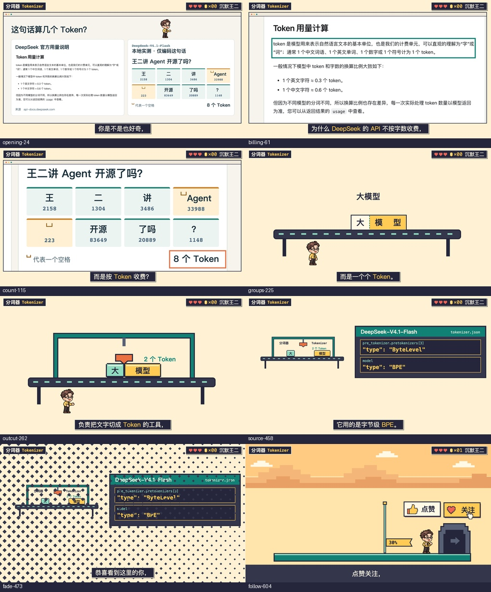
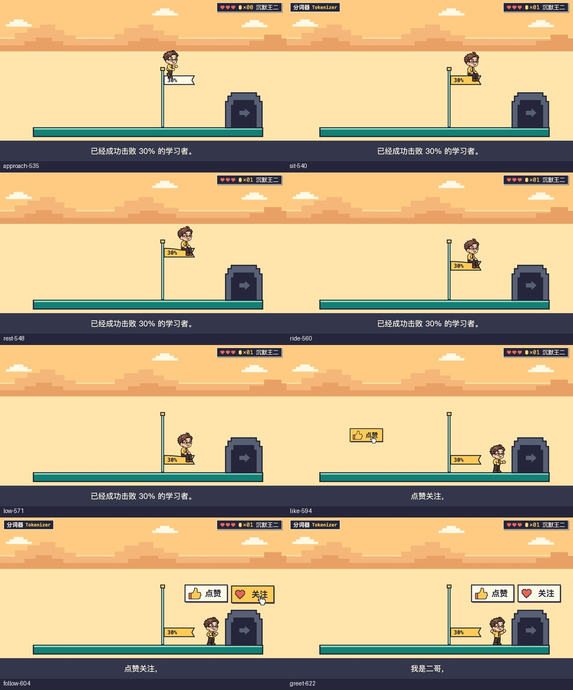

# 已认可样例 · Tokenizer 第一章

用户于 2026-11-07 确认《DeepSeek 用了什么分词器？》第一章，认可范围为 1920×1080、30 fps、663 帧的有声 Studio 预览。这里保存第一章初次认可时的成帧；五章复核后的杆高、姿势、独立截图、模型工位和最终动作以[整片定稿](APPROVED_PIXEL_FINAL.md)为准。五章稿件、第三方参考视频、配音与模型实测数据各有自己的来源；下次选用像素风时沿用制作方法，换成本期内容和音轨。



**图片和讲解。** 关键词“分词器 Tokenizer”占左上，署名“沉默王二”占右上。开场从原始页面以 4 倍像素密度取图，窗口固定，推近时将原文而非模糊缩略图带入视野。人物站在窗内留白，进入特写前退场。工作台只切一次字带，刀碰到分界时才显示两个 Token。打开配置时把同一台机器缩到左边。机制层切到跑道时用菱格遮罩，切换世界的当帧配轻扫提示音。[高清读数成帧](approved-pixel-ch1/billing-61.png)

**过关和按钮。** 跳上旗面坐稳，角色与旗面共用落座坐标；金币同步加一。人物双腿垂在旗前，随旗下降，低位跃回跑道。本例旗面 202×58 px；最终旗布写“30 分”，口播报“击败 30%”。下图是早期审片，最终旗面见整片定稿。过关镜头恢复深色通栏字幕。点赞牌与关注牌按两个词的起音入场，手形指针依次点按；声音对齐按下动作。[落座成帧](approved-pixel-ch1/sit-540.png)



## 为下一期准备

按主流程选定像素风并初始化项目后，在主仓库根目录运行：

```bash
SKILL_DIR="$PWD/.agents/skills/ergo-remotion-video"
python3 "$SKILL_DIR/scripts/install_pixel_assets.py" --project "$VIDEO_PROJECT"
```

`VIDEO_PROJECT` 为新视频项目的绝对路径。脚本将组件复制到 `remotion/src/`，人物到 `assets/images/`，音效试听件到 `assets/sfx/`。相同文件重复运行会跳过；遇到有本期修改的同名文件时会列出冲突，保留项目版本。正式章从本期 `ch<N>-phrase-timing.json` 读取时间，继续走原有逐步分镜、音画对齐和 Studio 审片流程。

| 素材或组件 | 用法 |
|---|---|
| [PixelWorld.tsx](../assets/PixelWorld.tsx) | 讲解用 `diagram`，关卡用 `platform`。传 `topic={{title, term}}`、累计金币数 `coins` 和对齐字幕。常规字幕 `captionStyle="plaque"`，关卡可用 `"band"`。人物和图片窗放在 `foreground`，机制图形放在 SVG 子节点。 |
| [PixelImageWindow.tsx](../assets/PixelImageWindow.tsx) | `file` 相对项目 public；`sourceWidth/sourceHeight` 为原页面 CSS 尺寸，`camera={{cx,cy,scale}}` 在同一套坐标中取景。角色与标注可作子节点，在图内一起变换。 |
| [WorldWipe.tsx](../assets/WorldWipe.tsx) | 传当前章帧 `f` 和切换世界的帧 `change`；放在世界前景之上、状态栏和字幕之下，`change` 同时用作提示音锚点。 |
| [FlagCourse.tsx](../assets/FlagCourse.tsx) | `FlagCourse` 放入舞台 SVG，`FlagRunner` 放入前景，两者共用 `f` 和 `frames`；把百分比放在共用的 `frames.percent` 中。旗面尺寸和臀部支撑点已配好。 |
| [LikeFollowTiles.tsx](../assets/LikeFollowTiles.tsx) | 可随旗面出场，也可独立放入 SVG；传 `frames={{like,follow,go}}`。按钮按下在各自起音后 3 帧，`go` 为按钮退完的时点。 |
| [人物精灵](../assets/pixel-actor/) | walk、carry、release 各为 1088×200 的八姿势横排图集，每格 136×200。sit 为 106×204 独立坐姿，臀部支撑点在图内 (45,163)。文件来自本期原创人物与已有的欧姆定律项目，坐姿依本期人物补绘。 |
| [像素音效](../assets/pixel-sfx/) | 两个原创 WAV 可单独试听。共用混音器按 `pixel_like`、`pixel_follow` 从[音效库](../../../../docs/src/ai/script/shared/assets/sfx/SOURCES.md)合成，再按 `sound-plan.json` 的 `beatId` 和 `offsetFrames` 加入旁白。本期分别为 −22 和 −23 dBFS。 |

旗面帧参数为章节局部帧，依次为助跑 `run`、起跳 `jump`、落座 `seat`、开始下降 `descend`、降到底 `bottom`、回到地面 `land`、走向入口 `go`、章节结束 `end`（不含该帧）。给落座停留和离旗落地各留可读的时间。只有稿中出现点赞、自介时传 `response: {like, follow, greet}`。本例用 540、593、603 帧对齐落座声与两次按钮声；换稿后按真实起音重新推导。

[本期完整分镜](../../../../docs/src/ai/script/what-is-tokenizer/OUTLINE.md) · [本机工程](../../../../docs/src/ai/script/what-is-tokenizer/remotion/src/Chapter1.tsx)。本期留存[4× 原始用量图](approved-pixel-ch1/ch1-usage-4x.png)、[截图与实测来源](approved-pixel-ch1/tokenizer-source.json)、[音效计划](approved-pixel-ch1/sound-plan.json)和[素材校验清单](approved-pixel-ch1/provenance.json)，供复核本次构图与同步；这些题材素材与通用人物包分别存放。
