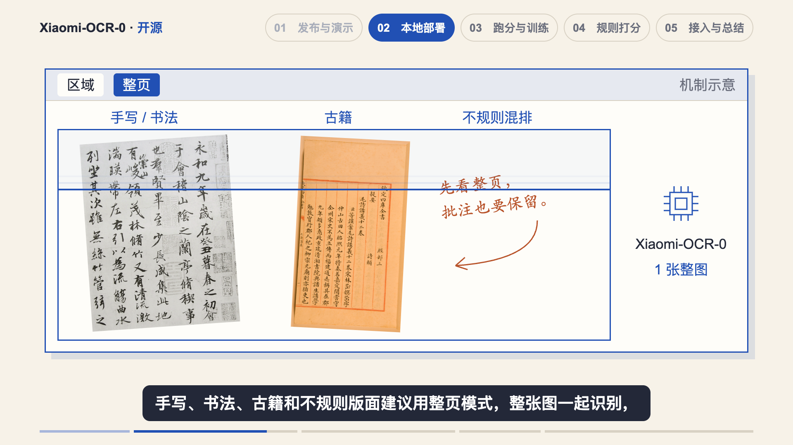
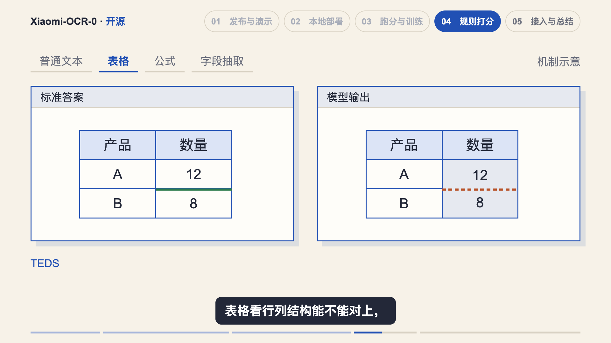
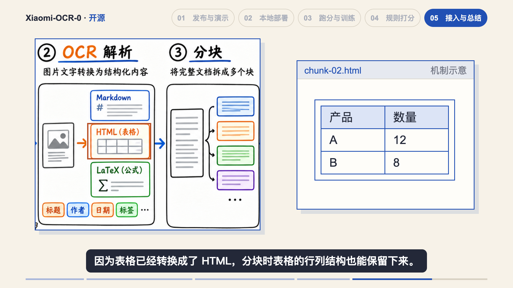
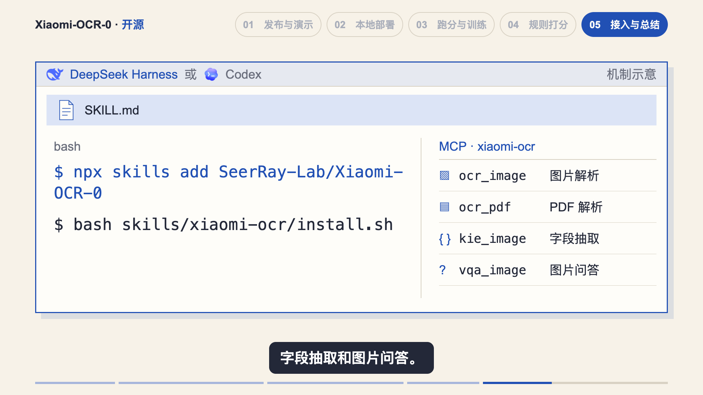

# Xiaomi-OCR-0 视频迭代样例

2026-10-31，用户要求把本次五章优化中适合复用的经验整理进 Skill。本页保留具体取舍、成帧和实现入口；通用规则见[用户偏好](USER_PREFERENCES.md)、[音画对齐](AV_SYNC.md)和[共享工作流](../../../../docs/src/ai/script/shared/WORKFLOW.md)。本期品牌、模型数量、扫描素材、坐标和帧号不作为其他视频的固定模板。

这些记录对应 Studio 预览与静帧检查，不表示已导出成片；第五章当时的审片状态以项目 `review.json` 为准。

## 模式对照要改变处理粒度

区域解析演标题、正文、表格和公式分区，四份载荷同时移动；进入整页解析后换成书法、古籍与不规则批注组成的完整输入，扫描带横跨整个宽度、从顶部走到底部，随后只发送一份整图载荷。典型材料和处理边界一起变，不能继续用四块区域的动画表示“整页”。

本例书法与古籍用有来源的原图，批注是构造内容，整个场景标明机制示意；没有伪造 OCR 转写。并行的通用判断是多路处理时间重叠，不要求所有任务一律同时完成。

实现：[ParsingModes.tsx](../../../../docs/src/ai/script/xiaomi-ocr-0/remotion/src/ParsingModes.tsx)、[WholePageScan.tsx](../../../../docs/src/ai/script/xiaomi-ocr-0/remotion/src/WholePageScan.tsx)。素材与边界：[whole-page-samples.json](../../../../docs/src/ai/script/xiaomi-ocr-0/assets/references/whole-page-samples.json)。

## 用具体内容演比对与保留

规则评分在同一标准答案/模型输出工作区中依次演示：额/领的单字符差异、数量列误合并造成的缺失行边界、公式指数 2/3，以及 JSON 先合法、再少一个闭引号。报错之后停止字段匹配，到对应口播才显示 0 分；标准答案与其他字段保持。

这里 TEDS、CDM 等指标只用于辨认规则，未实现完整指标计算，也没有自填 0.9 或用条形长度冒充得分。0 分来自报告明确的格式失败规则。迁移到其他主题时，先选能直观看见的最小差异，再判断应出现的后果。

RAG 表格分块则检查应保留的内容：`table.html` 成为 `chunk-02.html` 时，产品/数量、A/12、B/8 六个单元格及三行两列始终成组，变化发生在文件名和块边界上。原图左侧仍保留 OCR→分块的完整关系。

这是结构化分块的构造示例，不表示任意分块器都自动保持表格；这一点写在项目来源记录中，不在画面上追加解释段落。

实现：[RewardScoring.tsx](../../../../docs/src/ai/script/xiaomi-ocr-0/remotion/src/RewardScoring.tsx)、[RagIntegration.tsx](../../../../docs/src/ai/script/xiaomi-ocr-0/remotion/src/RagIntegration.tsx)。

## 接入过程使用具体工作区

先用完整真实目录建立依据，再在标明机制示意的工作区里演出：根 `SKILL.md` 链接发送和读取→收为附件→安装命令→环境和模型连接对象→MCP→四个实际工具名与中文用途。使用正式品牌素材，两个 Agent 表示可选入口，不画成同时安装。

本例没有实际安装、推理或注册服务，勾选仅表达口播中的教学过程。命令自然换行仍保留同一命令文本；确认稿中的命令简写与官方完整命令的差别记在来源记录里，不把画面当作完整 shell 转录。需要产品真实操作时，仍按既有录制约定执行。

实现：[AgentIntegration.tsx](../../../../docs/src/ai/script/xiaomi-ocr-0/remotion/src/AgentIntegration.tsx)。官方定义及示例边界：[ch5-iteration-sources.json](../../../../docs/src/ai/script/xiaomi-ocr-0/assets/references/ch5-iteration-sources.json)。

## 取景先核对素材，再保留完整关系

- 旧 `report-rl-head.png` 实际是上一节 CPT，旧 `github-skill-files.png` 丢了名称列。回到原始 PDF 和完整目录截图取景，不靠放大错误裁图补救。真实像素尺寸以文件为准。
- 跑分表保留版本、参数量和完整模型行；1.2B 对照项继续可见，但不圈进“1B 以下”的排名范围。
- 交叉标注图保持输入、专家、投票、一致与分歧、修正的整条链路同屏。通常只留当前框选；修正分支不画成必然通过，“最多 3 轮”保留“最多”。
- 独立数量条带按焦点实际宽高重算 `fitBox`，避免套整图比例带入半行邻段；需要解释完整链路时回到足够大的全貌。不要为了铺满宽度切到下方横幅。

实现：[Chapter3.tsx](../../../../docs/src/ai/script/xiaomi-ocr-0/remotion/src/Chapter3.tsx)、[第四章来源记录](../../../../docs/src/ai/script/xiaomi-ocr-0/assets/references/ch4-iteration-sources.json)。

## 总结和片尾仍按实际词句推进

总结保留同一个模型对象，按口播演本地权重、调用入口、基座、数据、专家与修正分支，再展开规则；不在前一个 beat 提前铺完所有统计。新的数量尚未说到时，保留相关数据对象承接画面，避免主体只剩一角的模型标签。

工具列表、数量、限制、登阶欢呼和点赞关注各用对应的词级事件。不要只以 `beat start + 90/190/300` 这类旧偏移定时；Sequence 中的登阶用局部帧，0–1 插值进度也不能误作帧号。

实现：[OcrRecap.tsx](../../../../docs/src/ai/script/xiaomi-ocr-0/remotion/src/OcrRecap.tsx)、[Chapter5.tsx](../../../../docs/src/ai/script/xiaomi-ocr-0/remotion/src/Chapter5.tsx)、[ch5-spec.json](../../../../docs/src/ai/script/xiaomi-ocr-0/assets/references/ch5-spec.json)。

## 迭代与检查记录

视觉迭代保持确认稿、全部配音、已有原图和其他章节；本期只按用户要求重配了 `server.py` 那一整句，后续视觉迭代以这个修正后的版本为基线。读音规则已入共享词典，不在这里另建一份替换表。重配后重建时间轴、受影响章节时点和混音；ASR 转写不代替实际试听。

布局沿用同一期的共享可用区域。本例自制工作区含阴影到 872px，原图和阶梯约 880px，字幕顶边约 935px；约 55–63px 的间距是本例结果，迁移时按实际元素和运动范围检查。关键静帧、起音帧与 Studio 播放共同检查过程和结果，不因类型检查或开口不空就认定机制正确。

记录入口：[第二章](../../../../docs/src/ai/script/xiaomi-ocr-0/preview/whole-page-audio-fix-20261031/review.json)、[第三章](../../../../docs/src/ai/script/xiaomi-ocr-0/preview/iteration-ch3-20261031/review.json)、[第四章](../../../../docs/src/ai/script/xiaomi-ocr-0/preview/iteration-ch4-20261031/review.json)、[第五章](../../../../docs/src/ai/script/xiaomi-ocr-0/preview/iteration-ch5-20261031/review.json)。

本页四张图按字节复制自项目 `preview/chapter2/scan-1490.png`、`preview/chapter4/table-405.png`、`preview/iteration-ch5-20261031/final-stills/tools-870.png`、`preview/iteration-ch5-20261031/final-stills/table-whole-1380.png`，未修改图片内容；静帧用于理解构图，不能替代动画播放检查。
