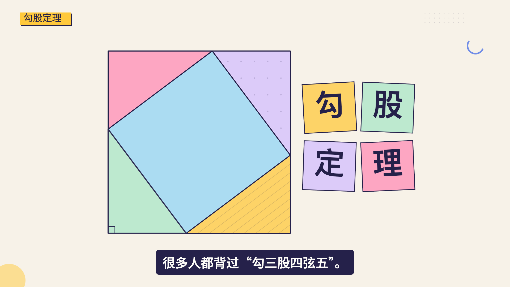
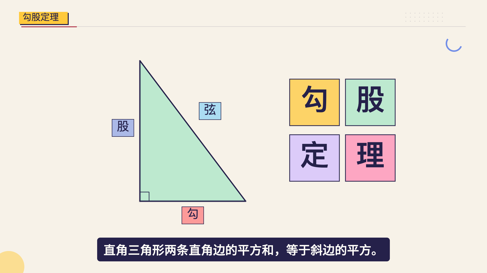
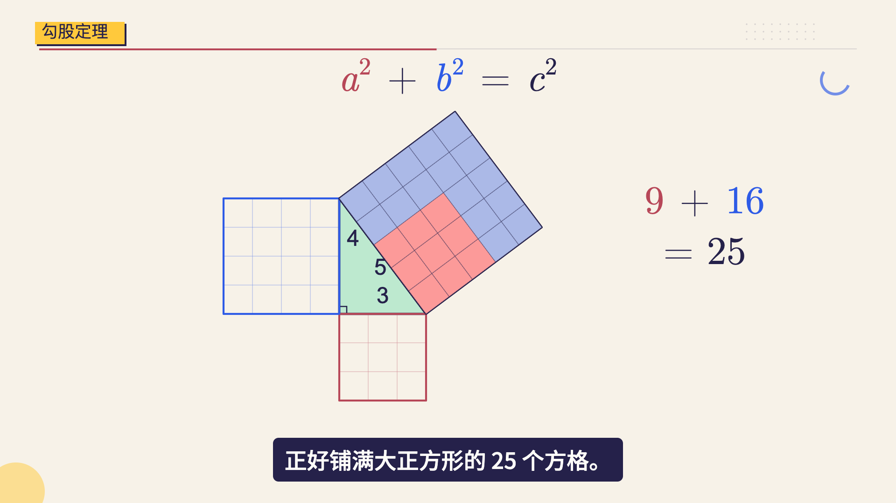
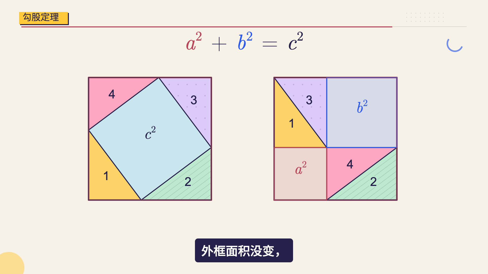

# 已确认案例：勾股定理 · 孟菲斯

2026-11-01用户确认最终配色，并要求把本轮开场、布局和拼图调整纳入Skill。此页记录可以迁移的做法及本例证据；四字题格和固定坐标不作为其他知识点的模板。

## 实际画面

| 首帧与选取 | 三角形与边名 |
| --- | --- |
|  |  |

| 面积搬运 | 拼图证明 |
| --- | --- |
|  |  |

## 从几轮返修中保留的取舍

- 开头直接给出完整彩色拼图和简短题字，约1秒内抽出正在讲的直角三角形。正文继续采用相同材质，数字按原口播时点出现。
- 主体采用浅薄荷色面`#BDE9CF`，三边统一靛色。粉彩标签、公式项和面积对象承担身份区分；去掉红、蓝、黑边线与大块黄色主体同时竞争的组合。
- 整个底边标记框锚定真实底边，不只检查文字。标签框在相机缩放前退出，字母标注平顺接手。
- 拼图只在少量色面使用条纹/疏点；纹理绑定物体顶点。绘制纹理后重建轮廓，落定拼片不留投影，避免假接缝干扰面积判断。
- 方格填色随真实对象搬运，源位置空出；四个三角形的尺寸、面积和刚体运动保持一致，后半段证明保留原编排。

## 本例数值与检查范围

画幅1920×1080、30fps、2401帧，约80秒。普通标签48px、数学符号60px、常驻公式84px、字幕48px；开场四字题块114px、临时公式100px。

底边框几何留白22px，计入两侧描边后约18.75px；框到字幕约53.4px。最终26个标签时点未发现整框与三角形相交，已检查中文转字母及缩放过渡。另已检查首两秒、公式转面积、390/740px缩图及正常速度播放；原稿、已确认配音和时间轴哈希保持一致。返修前后两处证明主体的像素对照一致。

这些数值说明这条片如何通过检查，不是通用配额。截图可说明构图，动态和听感需要实际播放；公开版未分发配音，也不宣称用截图证明有声成片验收。

## 可运行版本

[VibeScience仓库](https://github.com/itwanger/vibe-science)包含暖米与孟菲斯两版。按[样例说明](https://github.com/itwanger/vibe-science/blob/main/examples/pythagorean/README.md)运行后，选择`PythagoreanMemphisDemo`。公开工程保留完整画面、字幕和时间映射，为无声改编；不包含私人声音、音色ID或凭据。

本页图片由对应公开Composition复现，帧号、尺寸和哈希见[成帧记录](approved-memphis/provenance.json)。
