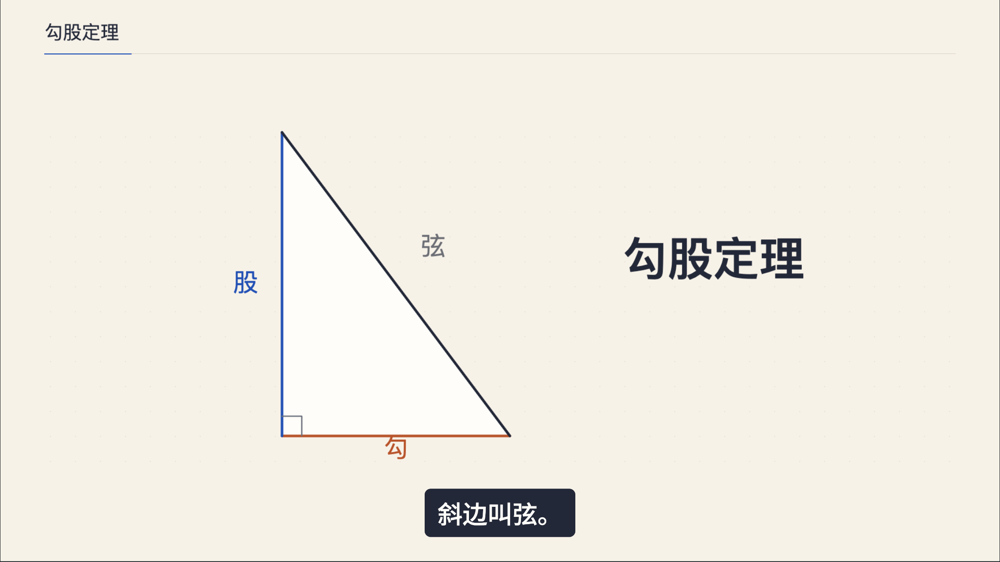
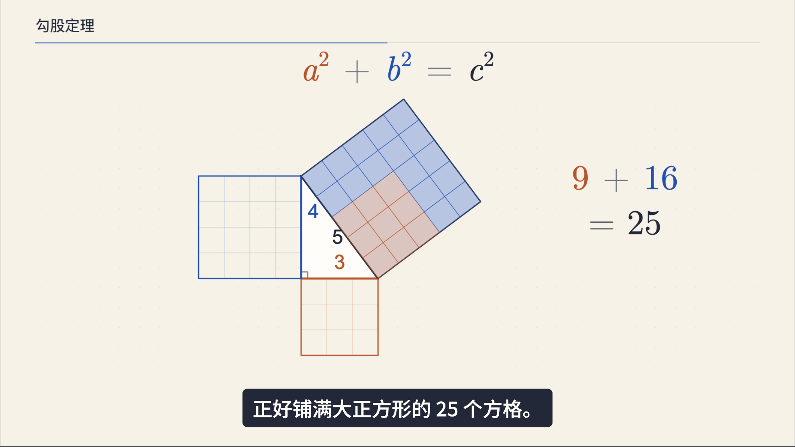
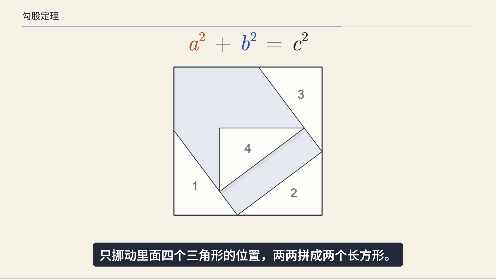
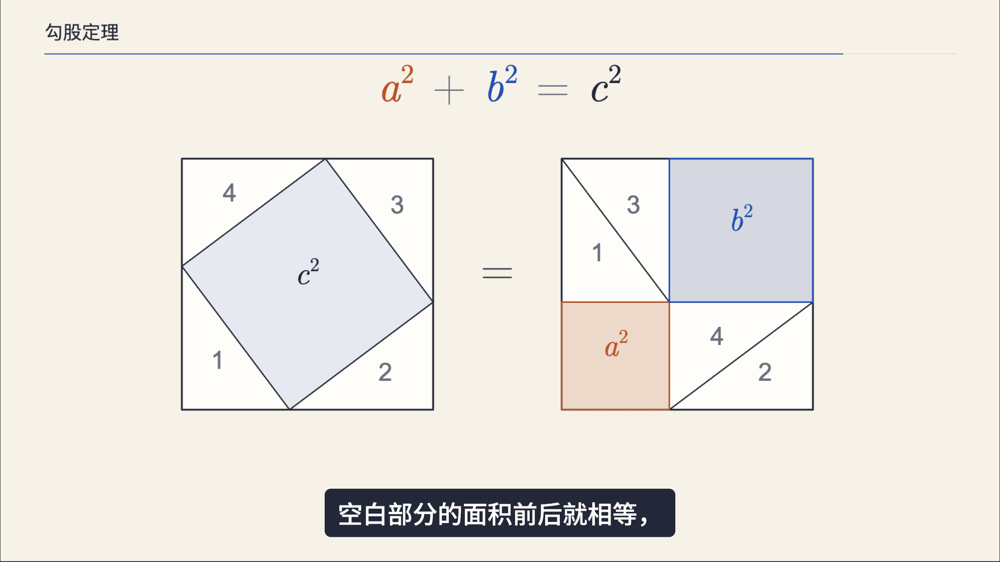

# 已认可样例：勾股定理

2026-10-31，用户认可`PythagoreanV2`整体预览并明确要求沉淀到本Skill。它展示本系列的字号、配色与连续因果表达，不是所有知识点的固定分镜模板。认可范围是预览及英文C读音方案；没有据此导出或发布MP4。

## 成帧与表达取舍

### 完整主体开场

第一帧就有三角形，随后用同色边名和描边引导视线。主标题只写“勾股定理”，去掉栏目名与期数。手机字号见[视觉规范](visual-style.md)，不要回退到长片的小字基线。

### 平方成为面积，方格真正搬走

三个正方形从所属边向外展开；25个单位格搬运时保持面积，原位置只留下空网格。公式及关键数值跟随讲解出现，不另放一列说明句。颜色贯穿边、面积与公式。

### 同一组拼图重排

四块三角形用编号保留身份；外框在重排时不动。移动块用短暂偏移阴影表示抬起再摆放，因此允许遮挡经过的块，不宣称是平面内无碰撞滑动。落定图形按真实比例与面积核对。

### 前后对照体现不变量

并排保留原拼法和新拼法，同步强调相同外框、同一组四块，再显出空白面积的等号。结尾改变a/b比例时重算整组几何，展示论证不依赖3-4-5这个特例。

这些成帧能说明版式，不能单独证明动作流畅或配音正确；动态与声音继续在实际工程验收。

## 英文C的试听与替换

用户否定了直接把c写成中文“西”的近似读法。沿用项目当前声音与原速，先独立生成约4秒的完整短句，用CMU音素`S IY1`指定英文C `/siː/`，用户实际试听后认可；随后才替换全片出现C的五个完整意群，共六处。其余意群复用原音频。字幕仍显示原稿的c，a/b的本例提示写法不推广为通用规则。

已认可短样本的完整纯文本为“斜边记作 C，就是诶平方加必平方等于 C 平方。”，两处C均以`<phoneme alphabet="cmu" ph="S IY1">C</phoneme>`标注。该文本记录的是当前项目输入，不是要求修改其他稿件中的a/b或新增解释性旁白。

该例短样本通过不代表其他声音或所有英文缩写都已通过；新语境按[局部替换流程](runtime.md#读音短样本与局部替换)复检。Skill不打包私人声音样本或凭据。

## 音频返修与时间轴

替换后新配音约80.03秒、2401帧/30fps。共享工具重建整条音频、ASR及强制对齐，再生成字幕和事件，保留未修改意群的音频哈希。

已有动画包含绝对设计帧，因此冻结原设计时间轴，通过41个语音事件/短语起点把新音频帧映射到原设计帧。映射统一发生在主画面入口；字幕、音轨和进度仍用真实音频帧。后来只把长字幕按语义拆成33组，音频未变，所以保留同一批有效语音锚点，不把字幕数量变化误判为需要重新配音。

实际字号及起始/中段/结果共27个状态核对，手机390px/740px缩图和独立静帧复查通过；最新33组字幕逐字拼接与原文一致，无横向溢出。整条按1x播放到片尾并正常循环。上述数量只记录本例，不固化为通用验收配额。

## 本机工程证据

- 工程：`ai-better/script/one-minute-what-is-pythagorean-theorem/`，默认Composition为`PythagoreanV2`，原版组件保留用于对照。
- [V2源码](../../../../docs/src/ai/script/one-minute-what-is-pythagorean-theorem/remotion/src/Chapter1V2.tsx)、[分镜](../../../../docs/src/ai/script/one-minute-what-is-pythagorean-theorem/OUTLINE-V2.md)、[审片记录](../../../../docs/src/ai/script/one-minute-what-is-pythagorean-theorem/review.json)、[英文C样本记录](../../../../docs/src/ai/script/one-minute-what-is-pythagorean-theorem/preview/pronunciation-c/sample.json)。本机路径用于复核，打包的四张成帧可独立查看。
- 成帧来源和哈希见[图片记录](approved-pythagorean/provenance.json)。来源文件的design帧号属于原设计时间轴，不是新音频的播放帧号，勿据文件名推断时码。
