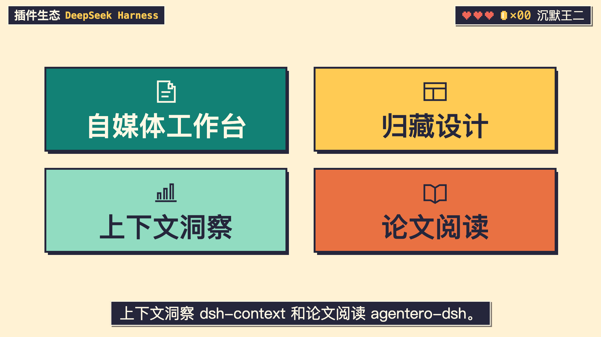

# 第一章像素镜头库

《DeepSeek Harness 四个插件》第一章已于 2026-11-09 获得二哥认可。下期按需要找画面、动作或转场。下面的时间是本期 30 fps 章内时间；换稿后，把触发帧重新对到新配音。

## 画面组件库

| 想画什么 | 取哪个组件 | 可换的内容 |
| --- | --- | --- |
| 一张大字图标卡，或截图中的四张卡 | [PixelPluginCard、四款像素图标与配色](../assets/PixelPluginCard.tsx) | 名称、28 × 28 图标路径、底色、字色。卡片以中心定位，自带描边、右下投影与可选勾选。单卡可独立使用。 |
| 插件集市 | [PluginMarket](../assets/PluginMarket.tsx) | 招牌、四个摊位、摊主和商品图标。集市与后面的点名卡共用一份名称、图形和配色。开市、资助和访客各有独立口播帧。[集市开张样片](approved-harness-ch1/market.webp) |
| 手机可读的图表窗口 | [PixelImageWindow](../assets/PixelImageWindow.tsx) | 原图、CSS 像素尺寸和相机。本期先展开绘图区，再在报数时推向终点。追光图层与原图共用坐标系。 |
| 游戏关底 | [FlagCourse 与 FlagRunner](../assets/FlagCourse.tsx) | 前者画砖阶、旗杆和旗布，后者画二哥。传同一份角色帧表，脚底与踏面、落座与旗面才会对齐。 |



## 对象动效库

| 动作 | 复用方法 | 本期样片 |
| --- | --- | --- |
| 沿折线追光 | [ChartLineTrace](../assets/ChartLineTrace.tsx) 接收原图尺寸、从左到右排列的采样点以及起止帧。`nodes` 逐节点停留、脉冲并更新读数；`continuous` 沿曲线移动，只给首尾节点打标。末段虚线按原图设置。 | [手机宽度的追光动图](approved-mobile-chart.webp) |
| 四卡依次登场、重排、让位 | [FourCardLineup](../assets/FourCardLineup.tsx) 接收四个词头帧。第一张居中，第二张到场才左右并排，第三张先占下排中央，第四张到场排成 2×2。`dockFrame` 让整组缩到左侧；`checkFrame` 在对应动作出现时打勾。 | [入场、让位中段与四格](approved-harness-ch1/cards.webp) |
| 开市、收币、引流 | [PluginMarket](../assets/PluginMarket.tsx) 的 `openFrame` 驱动卷帘依次抬起，`tokenFrame` 驱动金币落上柜台，`trafficFrame` 驱动访客走进街口。 | [看摊位与访客的相对位置](approved-harness-ch1/market.webp) |
| 二哥登阶、起跳、坐旗、下降 | [FlagCourse 与 FlagRunner](../assets/FlagCourse.tsx) 共用 `run / jump / seat / descend / bottom / land / go / end`。先定口播得分的落座帧，再排起跳与登阶。 | [从助跑到落座](stair-to-flag.webp) |

四张卡与市场可以共用下面这组输入。将组件放在 1920 × 1080 的 SVG 舞台里，`frame` 和 `cues` 来自当前章。单独做枚举时可省略勾选或靠左收拢。

```tsx
const items = [
  {name: '自媒体工作台', ...pixelCardThemes.manuscript},
  {name: '归藏设计', ...pixelCardThemes.layout},
  {name: '上下文洞察', ...pixelCardThemes.histogram},
  {name: '论文阅读', ...pixelCardThemes.paper},
] as const;

<FourCardLineup frame={frame} items={items}
  arrivalFrames={[cues.media, cues.design, cues.context, cues.paper]}
  checkFrame={cues.installed} dockFrame={cues.prompt} />
```

折线图先量原图。每个点用 `[x, y]` 表示，连续曲线的采样点只描述路径；标签只填写原图能读到的值。将下面的图层作为 `PixelImageWindow` 的子元素，`sourceWidth` 和 `sourceHeight` 与外窗传入的原图尺寸一致。终点标签可传 `endLabel={{text, x, y}}`，用原图坐标避开曲线和坐标轴。亮点、读数与字幕需在手机播放比例下可辨，复用已有检查帧核对。

```tsx
<ChartLineTrace points={points} sourceWidth={sourceWidth} sourceHeight={sourceHeight}
  mode="nodes" labels={readings} dottedLast frame={frame}
  start={cues.begin} end={cues.spokenValue} />
```

## 镜头转场库

第一章用了三种转场。[连续看三处真实切点](approved-harness-ch1/transitions.webp)。横移、上移共用工作区的 [MotionHandoffs / MotionPlane](../../../../docs/src/ai/script/shared/remotion/components/MotionSceneChain.tsx)，菱格使用 Skill 的 [WorldWipe](../assets/WorldWipe.tsx)。

| 切点 | 本期用法 | 下期替换什么 |
| --- | --- | --- |
| F420 · 14.00 秒，图表 → 插件集市 | `turn` 横移 22 帧，图表离开，集市从右侧进入 | 换场帧和交接时长；退场镜头停在切点前一帧，入场镜头跟随当前旁白。 |
| F583 · 19.43 秒，集市 → 插件点名 | `rise` 上移 20 帧，集市向上离开，点名画面自下方进入 | 给新画面留出阅读时间。HUD、字幕放在转场外层。 |
| F1290 · 43.00 秒，讲解 → 过关跑道 | 菱格在切点前后各 9 帧收拢、揭开，遮满时换世界 | `change` 对准换场帧。跨章时上章负责收拢，下章负责揭开。 |

`MotionHandoffs` 接收按帧递增的 `{at, duration, kind}` 数组、章内帧 `frame`、绘制当前内容的 `draw(frame)` 和主体裁剪区 `clipPath`。第一章的主体区为 `inset(86px 0 139px)`。菱格放在舞台上方独立绘制。用同一张图讲不同节点时，直接驱动图里的追光；点名新对象时，驱动卡片重排。

## 人物、声音和安装

[二哥姿势 PNG](../assets/pixel-actor/)随 Skill 安装到新项目的 `assets/images/`。[像素音效](../assets/pixel-sfx/)进入 `assets/sfx/`。本章横移用 `soft_whoosh`，上移和卡片登场用 `soft_pop`，菱格遮满用 `pixel_wipe`，离阶用 `pixel_jump`，落座用 `success_pair`。共享 WAV 位于[工作区音效目录](../../../../docs/src/ai/script/shared/assets/sfx/)，落点与响度写入本期项目的 `assets/references/sound-plan.json`。

新项目初始化后，从 toBeBetterJavaer 根目录安装像素素材包。

```bash
python3 .agents/skills/wanger-pixel-remotion/scripts/install_pixel_assets.py --project <新项目绝对路径>
```

组件和对象动效安装到 `remotion/src/`。镜头交接直接引用同一工作区的共享 Remotion 实现。本期官图、插件数据和音轨留在本期项目。[在 Studio 复看第一章](http://127.0.0.1:3031/Chapter1Preview)。
