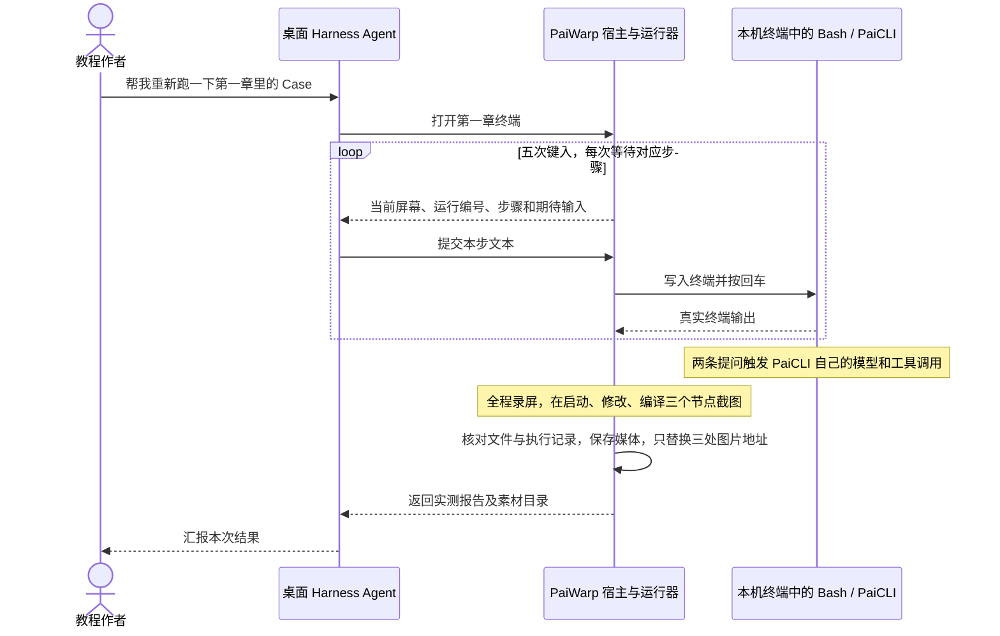

大家好，我是二哥呀。

突然想到的一个点子，就是给 DeepSeek Harness 桌面版做一个插件，这个插件里我可以让 DeepSeek Harness 帮我运行 PaiCLI，完成终端的一些截图。

因为像 Codex、DeepSeek Harness 这些桌面端 Agent，哪怕是给足权限，他们也说控制不了终端，这就让我很烦。

每次测试 PaiCLI，还要手动敲命令，截图，我就很受不了。


直接搞个终端插件，让 DeepSeek Harness 帮我完成测试，录屏，截图，不就好了？

当然了，开发工作仍然是交给 Codex 来做，我只需要把需求告诉它，虽然这个插件看起来不复杂，但可以和 PaiCLI、DeepSeek Harness、Codex 打通一套工作流，也是 PaiCLI 的一个更符合当前 AI 时代的一个应用场景。


面试求职也很好用啊。

现在打开 DeepSeek Harness 桌面端，选中 paicli 工作区，只需要在聊天框里发一句“帮我重新跑一下第一章里的 Case”，剩下的事情就不用我动手了。

桌面端的 Agent 会自己打开终端，依次键入构建、启动和测试指令，让终端里的 PaiCLI 完成修改代码和编译运行的任务；与此同时，插件在后台用 Chromium 和 xterm.js 把终端画面录成视频，并在启动、修改代码、编译运行三个时刻各截一张图。校验无误后，插件还会把图上传到图床，再把教程里的旧图替换掉。

这篇教程就把完整的过程讲给大家。

- DeepSeek Harness 桌面插件的工作原理
- 桌面 Agent 和 PaiCLI Agent 怎样通过终端衔接
- 自动录屏、截图、替换原图

## 01、桌面端怎么识别 paiwarp

DeepSeek Harness 收到提示词后：

```
帮我重新跑一下第一章里的 Case。
```


先调用 `paiwarp_run_chapter_one` 打开本机终端，接着连续调用 `paiwarp_terminal_input`，往终端里依次敲入内容。

```text
mvn clean package
java -Duser.home="$PAIWARP_SESSION_HOME" -jar target/paicli-1.0-SNAPSHOT.jar
读取 demo/src/main/java/com/example/Hello.java，把输出改成 Hello PaiCLI
进入 demo 目录，编译并运行 Hello.java
/exit
```


要让桌面端识别这套工具，得先按 DeepSeek Harness 的插件包（bundle）规范组织好插件目录。整个插件放在 PaiCLI 仓库的 `plugins/paiwarp-dsh` 目录下，核心入口声明在 `package.json` 里。

```json
{
  "name": "paiwarp-dsh",
  "version": "0.1.0",
  "description": "在本机终端复跑 PaiCLI 教程，验证产出、拍摄截图与录屏。",
  "type": "module",
  "main": "./host.js",
  "exports": {".": "./host.js", "./client": "./client.js", "./locale/*.json": "./locale/*.json", "./package.json": "./package.json"},
  "dependencies": {"@xterm/xterm": "6.0.0"},
  "engines": {"dsh": ">=0.2.2-rc.1 <0.3.0"},
  "dsh": {
    "bundle": {"patch": "./cordis.patch.yml"},
    "client": {"platform": "web", "inject": ["@deepseek-ai/dsh-api-remotes","@deepseek-ai/dsh-client-ui-sidebar-right","@deepseek-ai/dsh-client-ui-conversation"]}
  }
}
```

这份配置把插件分成了前后端两部分。


下文说的“宿主”，指桌面端里负责加载插件的 Node.js 后台进程。

- `main` 指向的 `host.js` 是插件在宿主进程里的入口，负责注册工具、校验工作区和启动 Python 运行器；
- `exports` 里导出的 `./client` 指向 `client.js`，运行在桌面端的 Web 界面里，负责渲染聊天卡片和右侧栏的终端面板。
- `locale/zh.json` 与 `locale/en.json` 提供插件管理页上显示的名称和简介。
- `dsh.bundle.patch` 指向同目录下的 `cordis.patch.yml`。DeepSeek Harness 使用 Cordis 加载扩展，Cordis 是一套负责管理插件加载、卸载和依赖注入的框架。下面这三行配置把 `paiwarp-dsh` 加载到宿主的启动列表里。

```yaml
- insert:
    - id: paiwarp
      name: paiwarp-dsh
```

本地开发和安装时，先准备好本机依赖，再通过桌面端“从本地目录安装”的入口把插件安装上。

- 本机环境：安装 Java 17 及以上版本、Maven、Node.js、`ffmpeg` 和 `ffprobe`，并为系统自带的 `/usr/bin/python3` 安装 Playwright（一套用代码控制浏览器的自动化测试库）及其配套的 Chromium 浏览器
- 安装前端依赖：从仓库根目录进入 `plugins/paiwarp-dsh`，在终端执行 `npm ci` 安装 `@xterm/xterm`
- 挂载本地插件：打开 DeepSeek Harness 桌面端的“插件”页面，点击“添加插件”，填入 `plugins/paiwarp-dsh` 的绝对路径，安装后点击“立即启用”


## 02、提示词怎么变成终端输入

插件启用后，在聊天框里只要输入“帮我重新跑一下第一章里的 Case”，DeepSeek Harness 就知道先调用 `paiwarp_run_chapter_one`，再连续调用 `paiwarp_terminal_input`。


为什么？

答案在 `host.js` 追加给模型的系统提示词（system prompt section）和工具定义里。`host.js` 在顶部声明了 `inject` 数组，向 DeepSeek Harness 申请使用五个宿主服务：

- `tools`：向当前会话的模型注册可调用的工具
- `commands`：注册聊天框里的斜杠命令 `/paiwarp`，用于查看终端状态、暂停、恢复或手动发送按键
- `workingDirectory`：获取并核对当前会话绑定的本地工作区路径
- `sandboxPolicy`：读取当前会话的权限模式，判断是立即放行还是弹出审批
- `systemPrompt`：往模型的系统提示词里追加插件专属的使用规则

```javascript
// plugins/paiwarp-dsh/host.js（节选）
ctx.systemPrompt.section({
  name: 'paiwarp:chapter-one', order: 530,
  text: '在 paicli 工作区，用户要求复跑第一章（第一期）的教程 Case 时，直接调用 paiwarp_run_chapter_one。它在本机专用终端输入教程命令和两个中文任务、检查 PaiCLI 的真实工具输出、截图录像、只更新对应图片地址。打开后，每当工具返回 waiting_input，就调用 paiwarp_terminal_input，按返回的 run、turn 和 expected 原样键入那一行。一直执行到 passed 或 failed；只在最终状态汇报。'
})
```

这段提示词给外层模型规定了明确的调用顺序。

模型看到用户要求复跑第一章的 Case，就先调用不带参数的工具 `paiwarp_run_chapter_one`。宿主收到调用后，先通过 `checkWorkspace` 校验当前会话的工作目录是不是插件所在的 PaiCLI 仓库根目录，再检查会话权限；如果当前不是最高权限模式 `danger-full-access`，就调用 `approval.request` 弹出桌面端自带的授权框，请用户确认。

校验通过后，`host.js` 用 `spawn` 启动 `/usr/bin/python3` 来运行 `run.py`，并逐行读取这个子进程在标准输出里打印的 JSON。每当 Python 运行器准备好接收下一行命令，就会打印一条 `kind` 为 `input` 的消息。`host.js` 把这条消息包装成 `status` 为 `waiting_input` 的 JSON 返回给外层模型，里面包含本次运行编号 `run`、当前步骤 `turn`、终端末尾的文本 `screen`，以及这一步应该键入的字符串 `expected`。

我们可以对照本次验收时从桌面端会话记录里导出的 `harness-inputs.json` 来看。桌面会话编号为 `session-1080ea23-479d-4cda-a59d-714c9e5d7211`，模型在收到 `waiting_input` 后，先后在第 `27`、`33`、`39`、`45`、`51` 号桌面事件里发起了五次 `paiwarp_terminal_input` 调用。其中第 `27` 号事件的记录如下。

```json
{
  "sequence": 27,
  "step": 1,
  "tool": "paiwarp_terminal_input",
  "text": "mvn clean package"
}
```

模型发起这次调用时，`host.js` 里的 `paiwarp_terminal_input` 执行器负责接收并核对参数。

```javascript
// plugins/paiwarp-dsh/host.js（节选）
async execute(args,exec) {
  const entry=runs.get(exec.agent)
  if(!entry || entry.run!==args.run) throw new Error('本会话没有这个运行')
  if(ctx.sandboxPolicy.resolve({session:exec.agent.session}).mode!==entry.mode) {
    entry.child.kill('SIGTERM'); await entry.done
    throw new Error('会话权限已改变，请重新开始运行')
  }
  const step=entry.ready
  if(!step || step.turn!==args.turn || step.expected!==args.text) {
    throw new Error('输入与当前 Case 步骤不匹配，本次未发送。'+
      (step ? JSON.stringify({run:entry.run,turn:step.turn,expected:step.expected}) : '该步骤仍在执行'))
  }
  exec.signal.throwIfAborted()
  entry.ready=null
  entry.next=latch()
  entry.child.stdin.write(JSON.stringify({action:'send',turn:step.turn,text:args.text})+'\n')
  return nextScreen(entry,exec.signal)
}
```

这段代码做了三项检查。

- 第一，核对运行编号 `args.run` 是否属于当前会话；
- 第二，检查会话的权限模式在运行途中有没有被改动；
- 第三，严格比对 `step.turn` 和 `step.expected` 是否与模型传来的 `args.turn`、`args.text` 完全一致。哪怕模型在文本里多加了一句解释，或者步骤编号对不上，宿主都会拒绝写入，并把正确的期望值返回给模型。

三项检查都通过后，宿主才通过子进程的标准输入管道 `child.stdin` 把指令发给 Python 运行器，然后等待终端的下一屏输出。

## 03、终端输入怎么交给 Bash 和 PaiCLI

宿主把 `{action: 'send', turn: 1, text: 'mvn clean package'}` 写进管道之后，Python 运行器怎么让这行字像人敲键盘一样输入终端，又怎样在同一个终端里先后运行 Bash、Maven 和 Java 进程呢？

先看 `run.py` 是怎么准备运行环境的。如果直接在仓库根目录里修改 `Hello.java`，跑完之后，文件里的 `Hello World` 就变成了 `Hello PaiCLI`，下次重跑时就没有处于初始状态的文件可用了。


所以 `run.py` 每次启动都会用 `tempfile.TemporaryDirectory` 创建两个临时目录：

- `paiwarp-ch01-*` 临时工作目录：把当前仓库的 `src` 目录和 `pom.xml` 复制过去，再把 `cases/chapter-01/Hello.java` 里的初始代码复制到 `demo/src/main/java/com/example/Hello.java`
- `paiwarp-java-*` 临时用户目录：通过环境变量 `PAIWARP_SESSION_HOME` 和启动参数 `-Duser.home` 传给 PaiCLI，让本轮产生的 `.paicli/history/raw/*.jsonl` 会话记录单独存放在这个目录里。这样做既能使用本机原有的 Maven 缓存、JDK 和 `.env` 文件里的 `DEEPSEEK_API_KEY`，又不会和本机使用的 `~/.paicli` 历史记录混到一起

接着，`terminal.py` 在 `Terminal.__enter__` 里调用 Python 标准库的 `pty.fork()` 创建伪终端。伪终端（PTY）是操作系统用软件模拟出来的终端设备，交互式程序连接到它上面，就和连接到真实的终端窗口一样。

```python
# plugins/paiwarp-dsh/terminal.py（节选）
self.pid, self.fd = pty.fork()
if self.pid == 0:
    try:
        os.chdir(self.work)
        os.execve("/bin/bash", ["bash", "--noprofile", "--norc", "-i"], self.env)
    finally:
        os._exit(127)
fcntl.ioctl(self.fd, termios.TIOCSWINSZ, struct.pack("HHHH", ROWS, COLS, 0, 0))
```

之所以不用普通的 `subprocess.Popen` 管道，是因为 PaiCLI 用的 JLine3 读取键盘输入、获取终端窗口宽度并渲染行内状态栏，这些交互功能都要求程序连接的是一个终端设备，普通管道不满足这个条件。

`pty.fork()` 返回的 `self.fd`，就是父进程用来读写这个伪终端的文件描述符。`pty.fork()` 创建子进程后，子进程切换到临时工作目录，启动一个不加载任何配置的交互式 Bash；父进程则把终端窗口尺寸固定为 `31` 行、`100` 列。

环境变量里还设置了一项很实用的配置，`PROMPT_COMMAND='echo $? > .paiwarp-last-status'`。

Bash 每执行完一条命令、重新打印提示符 `paiwarp $ ` 之前，都会先执行 `PROMPT_COMMAND`，把上一条命令的退出码写进 `.paiwarp-last-status` 文件。这样运行器不需要根据屏幕上的文字推测命令是否成功，读取这个文件就能拿到准确的退出码。

当 `chapter.py` 调用 `terminal.enter(expected)` 请求下一行输入时，`terminal.py` 会把步骤编号 `self.turn` 加一，把当前屏幕的最后 `3200` 个字符和应该输入的文本打印到标准输出，然后调用 `self.pump()`，等待宿主把 DeepSeek Harness 的输入传回来。

```python
# plugins/paiwarp-dsh/terminal.py（节选）
def enter(self, expected):
    self.turn += 1
    self.expected, self.agent_input = expected, None
    print(json.dumps({"kind":"input","turn":self.turn,"expected":expected,
          "screen":self.text()[-3200:],"phase":self.phase},ensure_ascii=False),flush=True)
    self.wait(lambda: self.agent_input is not None, 180, "Harness Agent 输入下一行")
    text = self.agent_input
    self.expected = self.agent_input = None
    for start in range(0, len(text), 5):
        self.wait(lambda: True, 5, "等待键盘")
        self.write(text[start:start + 5])
    self.write("\r")
```

拿到 DeepSeek Harness 传回的文本后，`enter` 每次取 `5` 个字符写进伪终端的文件描述符 `self.fd`，全部写完后再写入回车符 `\r`。写之前，`wait` 都会先处理终端输出，终端画面因此能随着按键逐段刷新，录出来的视频就像人在键盘上打字一样。

前两轮输入 `mvn clean package` 和 `java -Duser.home="$PAIWARP_SESSION_HOME" -jar target/paicli-1.0-SNAPSHOT.jar` 时，终端的前台进程是 Bash，所以这两条命令由 Bash 解释执行。

Java 进程启动之后，PaiCLI 成为前台进程，开始从同一个伪终端读取输入；之后的任务和最后的 `/exit` 虽然也是写进同一个 `self.fd`，但接收它们的是 PaiCLI 的输入框。


上面这张图是本次运行到 `00:18` 左右、PaiCLI 启动完成后，插件自动截取的画面，从中能清楚看到 `PaiCLI v16.1.0` 的启动框和当前使用的 DeepSeek 模型。

## 04、PaiCLI 怎么执行工具并留下记录

看到这里，你很容易产生这样一个疑问。

外面是 DeepSeek Harness，里面又在终端里运行 PaiCLI，那么修改 `Hello.java`、执行 `javac` 编译命令，到底是谁在做的？

把调用过程画在同一张时序图里，就能看清两层各自负责什么。



DeepSeek Harness 的角色相当于一位坐在键盘前照着教程做测试的你，只负责往终端里敲入指令；读文件、改代码、拼出 `javac` 和 `java` 命令，全都是终端里的 PaiCLI 自己调用模型和本地工具完成的。

打开 PaiCLI 的入口类 `Main.java` 可以看到，程序启动时会读取 `System.getProperty("user.home")` 得到用户目录（在这次运行里，就是插件传入的临时目录 `$PAIWARP_SESSION_HOME`），再调用 `ConversationLedger.openDefault(home)`，在 `.paicli/history/raw/` 下创建一个只追加写入的 `.jsonl` 会话记录文件，并把它交给 `Agent` 实例使用。

```java
// src/main/java/com/paicli/cli/Main.java（节选）
Path home = Path.of(System.getProperty("user.home"));
// ……初始化 SkillRegistry
ConversationLedger conversationLedger = ConversationLedger.openDefault(home);
Agent reactAgent = new Agent(llmClient, hitlToolRegistry);
reactAgent.setConversationLedger(conversationLedger);
```

当伪终端把第 `39` 号事件输入的“读取 demo/src/main/java/com/example/Hello.java，把输出改成 Hello PaiCLI”送进 PaiCLI 后，`Agent.runInternal` 把这句提示词作为 `user` 事件写进 `ConversationLedger`，然后进入 ReAct 循环，调用 `llmClient.chat` 请求模型。

```java
// src/main/java/com/paicli/agent/Agent.java（节选）
LlmClient.ChatResponse response = llmClient.chat(
        conversationHistory,
        toolExposure.definitions(),
        streamRenderer
);
if (response.hasToolCalls()) {
    appendConversationMessage(LlmClient.Message.assistant(
            response.reasoningContent(),
            response.content(),
            response.toolCalls()
    ), "llm_response");
    // ……通过本轮工具策略执行工具，并把每个 tool_execution 结果写进 conversationLedger
}
```


模型返回的每一个工具调用请求（`toolCalls` 中的一项）都带着一个唯一编号 `id`；工具执行完毕后生成的 `tool_result` 事件，会用 `toolCallId` 字段记录它对应的是哪个编号。`ConversationLedger` 把这些 `user`、`assistant` 和 `tool_result` 事件按发生顺序逐行追加到 JSONL 文件里。

在 `13:33` 这次实测的结果文件 `result.json` 中，可以看到 PaiCLI 处理的完整工具调用记录：

- 第一条：内层 PaiCLI 依次调用了 `read_file`、`edit_file`、`read_file`，也就是先读取原始文件，再把打印语句改成 `Hello PaiCLI`，最后重新读一遍，确认修改已经生效
- 第二条：内层 PaiCLI 调用 `execute_command`，自己生成并执行 `cd demo && javac -d out src/main/java/com/example/Hello.java && java -cp out com.example.Hello`，标准输出里有单独的一行 `Hello PaiCLI`


上面这张图对应录像 `00:30` 左右的画面，终端里同时显示了任务、`read_file` 与 `edit_file` 的调用信息，以及把 `Hello World` 替换为 `Hello PaiCLI` 的代码差异。

## 05、终端画面怎么变成桌面实况、录屏和截图

伪终端输出的是一串字节，里面混着普通文字、颜色控制码和光标移动指令。这串字节怎么变成 DeepSeek Harness 桌面端右侧面板里的实时画面，又怎么变成 PNG 截图和 MP4 呢？

如果直接录制整个 macOS 桌面，录屏分辨率会受显示器影响，画面里还会混入鼠标指针、弹窗通知或聊天框。

PaiWarp 换了一种做法，用 Playwright 启动无头 Chromium 浏览器（即不显示窗口、在后台运行的浏览器），打开插件自带的 `terminal.html`，在页面里用 `@xterm/xterm`（也就是 VS Code 内置终端所用的 `xterm.js` 组件）把伪终端的输出渲染成固定尺寸的终端画面。

看 `terminal.py` 里的 `Terminal.__enter__` 和 `pump()` 方法，就能明白这套渲染和采集流程是怎么工作的。

```python
# plugins/paiwarp-dsh/terminal.py（节选）
self.context = self.browser.new_context(viewport={"width": 1160, "height": 794},
        record_video_dir=str(self.output), record_video_size={"width": 1160, "height": 794})
self.page = self.context.new_page()
self.page.goto((PORTABLE / "terminal.html").as_uri())
self.page.add_style_tag(path=str(self.xterm / "css/xterm.css"))
self.page.add_script_tag(path=str(self.xterm / "lib/xterm.js"))
```

创建浏览器上下文时，窗口和录像尺寸都固定为 `1160 × 794`，并开启 Playwright 的页面录像功能。之后，每当 `pump()` 检查到伪终端 `self.fd` 有新的字节可读，就把它们解码成 UTF-8 字符串，再通过 `self.page.evaluate("s=>new Promise(done=>term.write(s,done))", ...)` 写进页面里的 `xterm.js` 实例。

为了让 DeepSeek Harness 桌面端右侧面板能显示实时画面，`pump()` 每隔 `0.8` 秒截取一张质量为 `78` 的 JPEG 预览图。JPEG 文件体积小，适合频繁刷新。写入时，`atomic()` 函数先把图片写进隐藏的临时文件 `.frame.jpg.part`，再用 `os.replace` 一次性替换掉 `.paicli/paiwarp/<会话哈希>/frame.jpg`，同时更新同目录下的 `state.json`。这样右侧面板任何时候读到的都是一张完整的图片，不会读到只写了一半的文件。

运行到关键时刻，`chapter.py` 会调用 `terminal.capture(name)`，先等待 `0.8` 秒，让终端画面绘制完毕，再调用 `self.page.screenshot` 把当前画面保存为无损的 `startup.png`、`edit.png` 和 `compile.png`。


终端会话结束后，`run.py` 调用 `ffmpeg`，把 Playwright 生成的原始 `.webm` 录像转成 `H.264` 编码、`yuv420p` 像素格式的 `session.mp4`，这种格式能被绝大多数播放器和网页直接播放。最后用 `ffprobe` 检查视频时长是否大于 `1` 秒，并检查 PNG 文件是否都大于 `1000` 字节。


那么，DeepSeek Harness 桌面端右侧栏是怎样把实时画面和最终的截图、录屏展示出来的？这要看前端入口 `client.js`。

开发这部分时，我遇到过两个问题。一开始，宿主后台已经跑通并生成了录屏，但点开桌面端右侧的页签却是空白，提示找不到查看方式。排查后发现，原因是把打开页签时用的 `kind` 和渲染页签内容时注册的 `id` 弄混了。

改正这两个标识之后，前端在执行命令和读取文件时又报错，原因是客户端插件模块没有显式声明它依赖的远程服务。

现在的 `client.js` 对这两个问题分别做了处理。

- 依赖声明：`inject` 数组显式列出 `['slots','sidebarRight','sidebarRightTabs','remote','remote.commands','remote.workspaceFiles']`，确保前端能调用 `/paiwarp` 命令，并分块读取工作区里的图片和视频文件
- 页签与插槽绑定：`sidebarRightTabs.register` 注册页签时指定 `id: 'paiwarp-dsh'`、`kind: 'paiwarp'`；工具卡片 `ToolCard` 调用 `sidebarRight.openTab('paiwarp')` 按类型打开右侧栏，而右侧栏内容插槽 `sidebar.right.pane.tab` 则绑定到 `key: 'paiwarp-dsh'`

```javascript
// plugins/paiwarp-dsh/client.js（节选）
return {
  inject:['slots','sidebarRight','sidebarRightTabs','remote','remote.commands','remote.workspaceFiles'],
  apply(ctx) {
    ctx.effect(()=>ctx.sidebarRightTabs.register({id:'paiwarp-dsh',kind:'paiwarp',multiple:false,
      priority:'builtin',title:()=> 'PaiWarp',guide:[{id:'open',order:21,title:()=> 'PaiWarp',description:()=> '第一章实测终端'}]}),'paiwarp.tab')
    ctx.slots.inject('tool.call.toolview',()=>ctx.slots.register({name:'tool.call.toolview',key:'paiwarp_run_chapter_one',
      inject:()=>({open:()=>ctx.sidebarRight.openTab('paiwarp')})},ToolCard))
    ctx.slots.inject('sidebar.right.pane.tab',()=>ctx.slots.register({name:'sidebar.right.pane.tab',key:'paiwarp-dsh',
      // ……注入 readText、readMedia 与 send
    },Pane))
  }
}
```

运行期间，右侧面板 `Pane` 每隔 `900` 毫秒读取一次 `state.json` 和 `frame.jpg`，刷新实时画面，画面下方还有“接管键盘”和“停止”两个按钮。一旦 `state.status` 变成 `passed`，面板顶部会显示“启动 PaiCLI”、“修改 Hello.java”、“编译运行”、“录屏”四个标签，点击任一标签，面板就会通过 `readBytes` 以 `512 KB` 为一块读取本地生成的 PNG 或 MP4 文件，并显示预览。

## 06、怎么校验运行结果

自动跑完测试、截好图之后，最关键的是两件事，一是判断这次运行到底算不算成功，二是把新图写回教程时，保证不改动正文。

先看 `chapter.py` 里的结果校验逻辑。用户输入的提问里本身就有 `Hello PaiCLI` 这几个字，回显到屏幕上时，这几个字也会出现。如果只看终端屏幕上有没有 `Hello PaiCLI`，即使程序没有真正运行成功，也会被误判为通过。所以 `execute()` 对每个阶段都从多个来源交叉核对。

- 构建与启动阶段：`.paiwarp-last-status` 里记录的 Maven 退出码 `buildExit` 等于 `0`，临时用户目录下已经生成了 `.paicli/history/raw/*.jsonl` 会话记录，并且终端画面里出现了 `PaiCLI`，三项都满足才截取 `startup.png`
- 修改代码阶段：磁盘上的 `demo/src/main/java/com/example/Hello.java` 文件内容已经包含 `System.out.println("Hello PaiCLI");`，并且本轮 `ConversationLedger` 记录的工具结果里调用过 `edit_file` 或 `write_file`，两项都满足才截取 `edit.png`
- 编译运行阶段：从会话记录里提取 `execute_command` 的调用参数和返回内容，同时检查四件事。工具返回结果包含 `exit code: 0`，返回内容里有单独的一行 `Hello PaiCLI`，`demo` 目录下生成了编译产物 `Hello.class`，执行的命令里包含 `java `。四项全部满足才截取 `compile.png`


上面这张图对应录像 `00:41` 左右的画面。PaiCLI 默认会把较长的命令输出折叠起来，并在屏幕上提示 `ctrl+o to expand`。所以 `chapter.py` 在截图前还会多做一步，如果检测到屏幕上有这行提示，就先往终端发送 `\x0f`（也就是 `Ctrl+O`）把工具输出展开，然后再截图。因此在这张图里，能同时看清编译命令、退出码和打印出来的 `Hello PaiCLI`。

三张图全部通过校验后，`replace_images()` 调用本机的图床上传脚本，把图片上传到 `cdn.paicoding.com`。拿到返回的 URL 后，插件还会用 `urllib.request.urlopen` 把线上图片重新下载下来，计算它的 `SHA-256` 摘要，并与本地 PNG 原图的 `SHA-256` 摘要比对，确保线上图片能正常访问，并且内容和本地原图完全一致。

最后一步是写回 Markdown 教程。第一期教程 `docs/articles/build-agent-from-scratch.md` 是我已经修改好的原稿，插件只允许更新第 `07` 节《跑起来看看》里的三张配图地址。`slots()` 和 `apply_urls()` 通过按字节定位，保证只改动这三处地址。

```python
# plugins/paiwarp-dsh/chapter.py（节选）
def slots(data):
    start = data.index("## 07、跑起来看看".encode())
    end = data.index(b"\n## ", start + 3)
    section = data[start:end]
    prompts = [s.encode() for s in PROMPTS]
    boundaries = [0, section.index(prompts[0]), section.index(prompts[1]), len(section)]
    found = []
    for a, b in zip(boundaries, boundaries[1:]):
        matches = list(re.finditer(rb"(?m)^!\[[^\]\r\n]*\]\((https://cdn\.paicoding\.com/[^\s()]+\.png)\)\s*$", section[a:b]))
        if len(matches) != 1:
            raise ValueError("第 07 节截图位置不唯一，保留原教程")
        m = matches[0]
        found.append((start + a + m.start(1), start + a + m.end(1)))
    return found
```

`slots(data)` 直接处理文件的原始字节（`bytes` 类型），而不是解码后的字符串。它以第 `07` 节标题、两条测试提问和下一节标题这四处文字为分界点，把第 `07` 节切成三个区间，并要求每个区间里只能匹配到一处 `https://cdn.paicoding.com/...png` 图片地址，然后记下这三处地址的起止字节偏移量 `(start, end)`。

随后，`apply_urls()` 只替换这三个区间里的 URL 字节，并且从最后一处开始往前替换。这样，即使新旧 URL 长度不同，替换后面的地址也不会让前面地址的偏移量失效。在把临时文件覆盖到原文件之前，还会重新读一次磁盘上的原文件，检查 `target.read_bytes() != original`。如果在插件运行的这几十秒里改动了文章，哪怕只改了一个标点符号，插件也会立即放弃写入并抛出异常，不会覆盖修改。

在 `plugins/paiwarp-dsh` 目录下运行单元测试 `python3 -m unittest -q test_chapter`，就能验证这套保护逻辑。

```python
# plugins/paiwarp-dsh/test_chapter.py
class ScreenshotBoundary(unittest.TestCase):
    def test_only_three_url_spans_change(self):
        original = (Path(__file__).resolve().parents[2] / ARTICLE).read_bytes().replace(b"\n", b"\r\n")
        urls = ["https://cdn.paicoding.com/case/%s.png" % i for i in range(3)]
        with tempfile.TemporaryDirectory() as directory:
            path = Path(directory) / "chapter.md"
            path.write_bytes(original)
            apply_urls(path, original, urls)
            actual = path.read_bytes()
            for (start, end), url in zip(slots(original), urls):
                actual = actual.replace(url.encode(), original[start:end], 1)
            self.assertEqual(original, actual)
            with self.assertRaises(RuntimeError):
                apply_urls(path, original, urls)
```

这个测试先把整篇教程的换行符改成 Windows 风格的 `\r\n`，执行替换之后，再把三处新的 URL 换掉旧 URL，断言整篇文档的每一个字节都和原来完全相同。接着，测试用替换前的旧内容作为对比基准，再次对已经改过的文件执行替换，验证这时会抛出 `RuntimeError`。


## PaiWarp 如何写到简历上？

**项目名称**：PaiWarp｜面向 PaiCLI 的终端 Agent 自动化测试插件

**项目简介**：PaiCLI 是面向研发场景的终端 Coding Agent。为验证其在真实终端中执行任务的能力，开发 DeepSeek Harness 插件 PaiWarp。用户在 DeepSeek Harness 中用自然语言发起测试，插件驱动本机 PaiCLI 完成交互、工具调用，并保存测试报告、关键截图与完整录屏。

**技术栈**：Node.js、Python、PTY、JSONL、Playwright、Chromium、xterm.js、FFmpeg、SHA-256

**核心职责**：

- 基于 Node.js 和 DeepSeek Harness 插件 API，为 PaiCLI 开发终端自动化测试插件 PaiWarp。将终端输入注册为可调用工具，使 DeepSeek Harness 收到用户的测试提示词后，能够调用插件启动本机 PaiCLI，按终端返回的状态提交下一步输入，直到获得该用例的测试结果。
- 基于 Python PTY 驱动真实的 PaiCLI 交互进程，通过 JSONL 在插件与本机之间传递就绪状态和待执行输入。
- 使用 Playwright 驱动 Chromium，通过 xterm.js 将终端画面展示在 DeepSeek Harness 侧栏。在关键节点自动截图，并用 FFmpeg 生成录屏。
