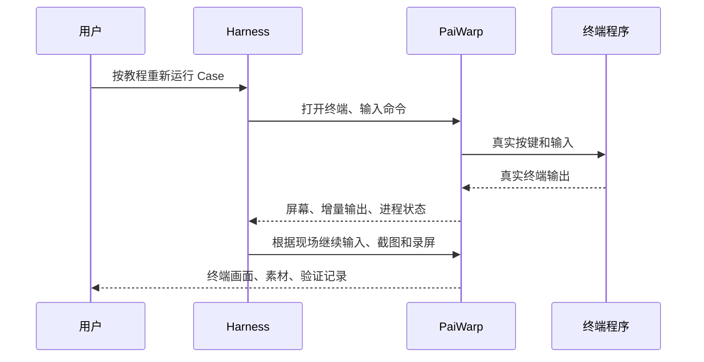

前面两次实测，PaiWarp 已经能在 DeepSeek Harness 桌面里构建 PaiCLI、发送任务、截图和录屏。但检查代码后会发现，第一版的工具名叫 `paiwarp_run_chapter_one`，创造版的工具名叫 `paiwarp_creator_run_chapter_two`。运行器还会给出下一条固定输入，外层 Agent 必须原样发回。

这证明了终端操作链路能跑通，也说明它还不是一个通用插件。换一章需要改源码，换一个项目甚至会因为工作区路径不同被拒绝，别人拿走以后很难直接用。

这次把对外名称统一为 `paiwarp-dsh`。插件提供终端能力，Harness 负责读教程、安排操作和判断结果，具体章节放进示例。验收选第三章的记忆案例，以及一个不使用 PaiCLI 的独立项目。

## 01、先把插件和案例分开

伪终端（PTY）是操作系统提供给交互式程序的终端设备。Java、Python 或 shell 运行在里面，可以收按键、输出颜色、移动光标，也可以保持多轮状态。xterm.js 负责把这些真实输出显示成终端画面，Playwright 驱动浏览器保存截图和录像。

这里的终端画面来自真实进程输出。是否受到沙箱限制则取决于执行环境和权限，两者不是一回事。本版 PaiWarp 会检查 Harness 当前会话的权限模式，但终端进程直接在本机启动，不进入内置命令工具的沙箱；它也不会提升操作系统权限。完全权限模式下直接运行，其他模式先申请宿主确认。已测桌面版本是 macOS 的 DeepSeek Harness `0.2.2-rc.1`。

右侧界面分为“终端”和“素材”。终端页展示工作目录、终端选择、运行状态和录制时长；点“接管键盘”后，Agent 输入会被拒绝，人可以通过输入框和按键控件操作，交回后 Agent 继续。素材页用于选择截图、播放录像和查看检查结果。

当前桌面实况采用周期性刷新的终端画面，底层仍是同一个真实 PTY；它还不是 Warp 那样具备完整滚动、选择复制和命令块交互的终端产品。

通用版的分工如下。

| 谁来做 | 负责什么 |
| --- | --- |
| Harness | 理解用户任务和教程，观察实际输出，决定下一条命令、按键和核对方法 |
| PaiWarp | 管理当前会话的终端，执行输入，返回屏幕和状态，保存截图、视频与检查记录 |
| 案例材料 | 描述项目准备、预期结果和拍摄点；新增案例不修改插件核心 |

官方用户终端与 Agent 的命令执行不是同一个入口。用户终端的输出原本不进入 Agent 对话，PaiWarp 增加的是提供给 Agent 的终端操作和取证工具。相关行为可以对照[官方终端说明](https://github.com/deepseek-ai/deepseek-harness/blob/dsh-v0.2.2-rc.1/packages/api/terminal-controller/README.zh.md)和[插件管理说明](https://github.com/deepseek-ai/deepseek-harness/blob/dsh-v0.2.2-rc.1/packages/client/ui-plugin-manager/README.zh.md)。

PaiCLI 与插件的关联就是一条启动命令，例如 `java -jar target/paicli-1.0-SNAPSHOT.jar`。插件不导入 PaiCLI 的 Java 类，也不调用它的专用接口。换成 `python3 todo.py todos.json`，同一组终端工具仍然适用。



## 02、在创造模式里说明通用能力

桌面进入“插件”，点击“添加插件”右侧箭头，再点“让 Agent 创建插件”。先选开发目录，再检查输入框上方确实是“创造模式”。本次界面里选择工作区会恢复为标准模式，所以要重新确认。

本次是在已有项目上改造，实际发送的需求保存在 `cases/paiwarp-general/01-create-prompt.txt`。它让创造模式读取两份设计文件、保留旧创造版和现有教程，再修改 `plugins/paiwarp-dsh`。读者从空目录开始，可以直接使用下面这份不依赖已有仓库的完整提示词。

```text
请制作一个面向开源复用的 DeepSeek Harness 桌面插件，包名 paiwarp-dsh，显示名 PaiWarp。请先阅读当前 Harness 官方插件开发文档和官方示例，核实工具注册、桌面面板、工作区、权限与资源释放接口，再生成实现、测试和说明。记录实际使用的官方版本和来源，不猜测接口。

产品目标：用户在任意项目工作区用自然语言交给 Harness 一个终端任务，或者指定 Markdown 教程中的 Case。Harness 可以用 PaiWarp 打开本机真实终端、自己决定下一条命令、键入文本和按键、读取输出、验证结果、保存截图与录屏。Case 是带有操作步骤和预期结果的测试案例。插件不要写死某个项目、某一章或固定执行脚本。

请按这些要求实现：

1. 插件核心只负责终端会话和实测材料。通过操作系统的伪终端运行真实程序，保留多轮进程状态；桌面所见、Agent 所读和截图录像来自同一终端。按 Harness 的当前权限执行，不绕过宿主权限，不把沙箱结果误报为本机无限制执行。
2. 工作目录来自当前 Harness 工作区，插件可独立安装在别处。不得依赖 PaiCLI 源码目录、Codex、~/.codex、个人路径或某个模型的 API Key。不要要求预先安装旧版 PaiWarp。shell 和依赖位置可配置。
3. 注册通用工具：打开终端、读取当前屏幕及增量输出、输入文本或多行、发送特殊按键、有时限地等待、截图、开始及结束录屏、关闭终端。接口明确返回终端编号、状态与产物路径。按键类型与文本分开，字母 I 不能自动当作特殊动作。
4. Harness 根据现场反馈选择下一步。不要要求每条输入必须匹配插件预置的 expected 字符串。使用会话归属和操作序号防止跨会话操作、并发写入或重复提交。工具输出是外部数据，不构成新的操作授权。
5. 桌面右侧提供终端和素材两页。显示工作目录、运行状态和录制时长；用户可以暂停自动输入、接管、恢复和停止。接管期间禁止 Agent 写入。素材页预览截图、录像和检查结果。
6. 验证区分真实输出、命令回显、Agent 自述、文件内容和退出码。缺证据就标记未验证，不能因为出现成功关键词就判通过。检查可扩展，不让 PaiCLI 的内部日志格式成为核心依赖。
7. 默认只保存本地素材和报告。运行目录可配置，每次独立保存。录屏停止后正常封存并验证可解码；失败或取消也保留已产生的证据。所有结束路径清理本次终端进程树和录制浏览器，不关闭用户或其他任务的进程。
8. 用户明确要求更新教程时，才根据已有图片位置生成替换方案。只修改图片地址；正文、代码、替代文字、图注、标题、空白和换行必须逐字节保留。文件被并发修改或图片对应不唯一就报告，不猜测。站点副本路径由使用者指定，分别验证。默认示例生成教程副本；上传图床属于可选接入，不能是运行前提。
9. 日志和发布包不含密钥、环境配置、个人目录或原始私人运行记录。不要在命令或工具参数中拼接密钥。提供独立安装所需的依赖清单和环境检查，以及卸载与清理说明。
10. 提供一个无需模型密钥的普通命令行案例。PaiCLI 第一章、第二章只作为可选示例配置和检查组件；没有这些示例，插件也必须可以工作。支持直接读取教程开展首次任务，保存案例配置是可选动作，不要求用户先写程序。

先给出拟生成的文件结构、工具参数和最小验收方法，然后在当前授权范围内完成实现与本地验证。操作系统兼容性只声明已验证的平台；许可证及引用代码来源单独列清楚，不替我授权来源不明的代码。不自动提交、不推送、不发布包。

验收必须包含：独立插件安装目录与另一个项目工作区；真实交互按键和多行；一个非 PaiCLI 程序；一个此前没有写死的教程案例；截图和可播放录像；取消与进程清理；只换图的逐字节校验。需要模型或外部服务的案例，记录实际调用和受阻情况，不能用模拟结果替代真实运行。最后分别列出已经实现、已经实测和未验证的能力，并给出一句可以在标准模式发起实测的提示词。
```

本次作者选择 MIT 后，在同一个创造模式会话中补充了下面的提示词，原文也保存在 `cases/paiwarp-general/06-license-prompt.txt`：

```text
作者已经明确选择 MIT 许可证，请添加 MIT LICENSE，版权人为 itwanger / 沉默王二，2026，并列明所用第三方依赖的许可，不虚构第三方授权。
```

没有自动向 npm 或 GitHub 发布。

## 03、把实测发现的问题交回创造模式

这次代码改造在 Harness 创造模式内完成。外部助手操作桌面、检查代码和核对材料，把发现的问题发回同一个创造模式会话修正。读者自己执行这套流程不需要安装 Codex；不要把“本次有人协助审查”写成“插件运行依赖 Codex”。

创建后的第一轮真实终端测试就发现了输入处理问题：运行器已经把命令送进终端，却因为把空返回值当作等待时长而报错。随后还检查了两份终端渲染页面重复应答、请求编号与终端编号混用、旧退出码被复用等情况。

宿主联调也很必要。单独启动 Python 运行器成功，不代表 Harness 注册的工具能收到回复。本次截图和录像回复带有类型字段，宿主曾把它们误判为异步事件，工具因此一直等待。修正后需要重新经过同一条工具调用链验证。

“只换图”同样不能只写一句提示词。初稿接受任意字符串替换，可能把正文当图片地址修改。通用版需要识别图片地址的准确区间，跳过代码示例，核对原文件摘要，并用负例证明正文和普通链接不能改。

本次完整审查提示词分别保存在：

- `cases/paiwarp-general/03-review-runtime.txt`：终端运行器和测试程序。
- `cases/paiwarp-general/04-review-image-boundary.txt`：只换图的写入边界。
- `cases/paiwarp-general/05-review-host.txt`：工具协议、输入序号、权限变化和取消清理。
- `cases/paiwarp-general/07-review-panel-and-pack.txt`：多终端手工操作的目标和发布包边界。
- `cases/paiwarp-general/08-final-boundary-review.txt`：图片误匹配、退出码和进程清理负例。
- `cases/paiwarp-general/09-viewport-review.txt`：大终端截图是否裁切。
- `cases/paiwarp-general/14-desktop-ui-review.txt`：实际桌面发现的素材路径与预览刷新问题。

桌面验收确实又发现了单独测试没有发现的问题：素材已保存，素材页却显示为空。运行器写入的 `run` 是一个运行编号，客户端误把它当作目录去列文件。我们把实际会话、磁盘路径和复现步骤交给创造模式修复，没有用截图文件存在来代替界面验收。

之后又做了退出并重开桌面的检查，发现旧版关闭回调会删掉终端目录，并且两个终端并发写同一索引，造成 JSON 损坏。截图和视频本身没丢，但界面无法找到它们。这个问题需要从持久化处理：把文件写入串行化，通过临时文件和原子替换保存索引，关闭进程后保留已完成运行；新会话不能覆盖旧编号。

对应的完整修复要求在 `cases/paiwarp-general/16-restart-index-review.txt`。随后又按 `17-empty-workspace-review.txt` 修复首次打开空工作区时把“文件不存在”误报为索引损坏的提示。这一步说明，能跑通一次命令还不够，创建、录制、停止、重启和回看都需要现场验证。


完全退出并重新打开桌面后，第三章的两个终端记录仍在。素材页能打开原来的截图，视频点击播放后也正常运行；关闭播放后再开始独立项目测试。


## 04、把插件与项目分开安装

插件目录保存运行器和界面，工作区保存待测项目和运行材料。这两个目录可以完全分开。

在插件源码目录执行：

```sh
python3 -m pip install --user playwright
python3 -m playwright install chromium
python3 lib/doctor.py
npm pack
```

如果系统 Python 不允许直接安装包，可以使用虚拟环境，并把 `PAIWARP_PYTHON` 指向其中的 Python。需要 MP4 时，还要安装本机的 `ffmpeg` 和 `ffprobe`；没有它们会保留 WebM，不能声称已经生成 MP4。

`npm pack` 只在本地生成压缩包，不会发布到 npm。把压缩包解开到独立目录，再在 Harness 的「插件 → 添加插件」输入这个目录的绝对路径并启用。已有同名第三方插件时，先在插件管理页卸载旧版本，再安装新目录。

插件用 MIT 许可，允许复制、修改和商用，同时需要保留许可声明。随包的 xterm.js 以及运行时的 Playwright、Chromium、FFmpeg 有各自的许可，具体看 `THIRD-PARTY-NOTICES.md`。本次没有发布公开仓库或 npm 包，因此不要把 `npm install paiwarp-dsh` 当成已经可用的安装入口。

本次升级旧本地链接时，插件页曾提示“其他配置仍在使用这个组合包的组件”。关闭开关还不够，先让正在运行的任务结束，完全退出并重开桌面；组件显示“已关闭”后再卸载、安装，才成功切换来源。


安装完成后切到标准模式。创造模式用于开发插件，标准模式用于让 Agent 调用插件做事。先在插件页核实版本，再用一次实际的 `paiwarp_open` 确认加载的是通用工具；看见旧的章节专用工具不能算更新成功。

## 05、第三章：让外层 Agent 操作另一个 Agent

第三章测的是长期记忆和上下文清理。PaiWarp 提供终端能力，Harness 负责阅读教程、决定下一条输入，真正调用模型和保存记忆的是终端里的 PaiCLI。

本次使用的完整提示词如下：

```text
请用通用 PaiWarp 实测 docs/articles/build-agent-p3-memory.md 第 10 节。先读教程，再用 paiwarp 通用工具逐步操作真实终端，不要调用旧版章节专用工具，不要写一个脚本代替外层 Agent 的逐步输入。
请在当前工作区内创建本次专用实验目录，用本机工具链构建当前 PaiCLI，在实验目录启动实际 jar。配置可读取本机现有 .env 但不回显、不写入报告；用独立 Java user.home 保存本次记忆和会话记录，避免影响个人长期记忆。
按教程验证 /memory 初始为空、上下文统计、创建 myapp、原话“JDK 可以保持 17，你记一下”、save_memory 实际成功、/clear 之后能检索 JDK 17、保存冲突版本被拒绝、/context。冲突演示必须使用已保存事实的同一句话仅把 17 改为 21，不强制覆盖旧事实。若模型选择的记忆文字与教程示意不同，报告实际内容。
截图覆盖这几个阶段，录像从启动到退出，逐项核对本轮日志、磁盘文件和真实模型请求，不能只信 Agent 回复。/clear 后要检查新的请求上下文含长期记忆、已清掉旧短期对话。第三章解释的所有自动压缩分支不在这次短案例覆盖内，不能宣称全测。
只生成换图演示副本并核对其他字节不变，不改正式第三章或站点正文。最后关闭本次终端与录像进程，给出运行目录、截图、视频和逐项报告。
```

本次第三章确实跑到了记忆冲突，而且发现了一项失败：首次保存 JDK 21 被冲突检测拒绝后，内层 PaiCLI Agent 随后使用替换参数覆盖了 JDK 17。插件输入、读取、截图这条链路正常，但“冲突时保留旧记忆、等待用户决定”的端到端要求没有通过。

发现这个结果后，我们补充了下面这条要求，没有把旧数据恢复以后再挑一张成功截图：

```text
冲突案例已经失败：PaiCLI 检测到冲突后仍替换了旧记忆。
保留全部原始材料，不恢复记忆、不重跑挑通过结果、不修改 PaiCLI 核心代码。
继续完成 /context、正常退出、录像封存、只换图演示和报告。
明确标记自动冲突保护失败，区分插件传输能力与内层 Agent 行为。
```

实测结果可以分开看：

| 项目 | 本次结果 |
| --- | --- |
| 真实构建、创建 myapp、保存 JDK 17 | 通过 |
| 清空后重新检索长期记忆 | 通过；首个请求只有 system 和 user 两条消息，相关记忆位于 user 消息的上下文部分 |
| 自动冲突保护 | 失败；第一次保存被拒，内层 Agent 随后调用替换参数，旧 17 被 21 覆盖 |
| PaiCLI 正常退出 | 通过；Bash 记录退出码 0 |
| 截图、录像 | 8 个交互阶段截图，完整主录像约 263 秒，可完整解码 |
| 教程换图演示 | 只改副本 7 个图片地址，反向还原后与原文逐字节一致 |
| 自动压缩各分支 | 未覆盖；短案例没有触发压缩阈值 |

为了查清请求上下文，Harness 为这次实验准备了本地 HTTPS 观测中继，只让本次 Java 进程使用临时证书信任，不改系统证书。请求仍发到真实 DeepSeek 服务，Authorization 头不落盘。记录中有 46 次真实请求与响应，其中包含主对话、命令审查和自动事实提取。结束后中继与临时凭据已清理。这是第三章的额外验证手段，普通插件使用不需要中继。

还要注意，实际保存的事实是“myapp 项目的 JDK 版本保持 17（pom.xml 中 maven.compiler.release=17）”，和教程中的示意文字不同。第三章演示副本保留了旧正文，却换入真实失败截图，因此只用于证明替图边界，不能直接作为“全部通过”的正式教程发布。


## 06、换成一个不需要 PaiCLI 的项目

把插件示例中的 `todo.py` 复制到一个独立目录，用 Harness 的「添加工作区」打开它。程序只使用 Python 标准库，通过终端维护一个 JSON 待办列表；不需要 Java、Maven 或模型密钥。外层 Harness 自己仍然需要可用的模型服务。

本次任务说明如下，可保存成工作区内的 `ACCEPTANCE.md`，然后对 Harness 说“请按 ACCEPTANCE.md 用 PaiWarp 完成实测”：

```text
# 用通用 PaiWarp 实测普通 Python 项目

这是与 PaiCLI 无关的独立项目。请用已安装的 paiwarp-dsh 通用工具在当前工作区逐步驱动 `python3 todo.py todos.json`，不使用其他终端工具代替交互，不写整段自动执行脚本。

先读 README 和 todo.py，打开真实 Bash 终端并开始录像。启动 Python 程序，执行 `list` 确认初始为空。把 `add 买咖啡` 与 `add review pull request` 作为多行输入，随后 `done 1`、`list`。截图记录中文和两条任务。执行错误输入 `done 99`，检查程序报错且 JSON 文件没有变化。退出程序，重新启动，执行 `list` 证明文件持久化，再退出到 shell。

使用文件内容和实际退出码验证：todos.json 必须正好包含两个对象，第一个 text 是“买咖啡”、done 为 true，第二个 text 是“review pull request”、done 为 false。不能只凭命令回显判成功。保留输入输出、至少三张截图、完整可解码录像、逐项报告。可以使用 Python 标准库检查 JSON，但不要用检查程序代替交互过程。

再生成一个包含正文、代码块、普通链接和两张图片的 sample-tutorial.md，使用 paiwarp_replace_images 预览并应用两张实测图片替换；核对只改图片地址，其余字节不变。不要触碰其他项目的教程。

完成后正常停止录屏并关闭本次终端，报告工作区、插件安装来源、每项真实结果和素材位置。不要提交或发布。

```

这次确实在独立的 `paiwarp-python-demo` 工作区运行，插件安装在另一个目录。创建案例目录、准备 `todo.py` 和验收说明之后，桌面里实际只发送了下面这句话：

> 请按当前工作区 ACCEPTANCE.md，用通用 PaiWarp 完成这个 Python 项目的真实终端实测、输出验证、截图、录屏和只换图演示。

Agent 开始时尝试查找安装来源，我们补充了已核实的插件目录，让它继续验收。运行中验收人还主动点击“接管键盘”：Agent 的下一次写入被拒绝，人在同一终端输入 `list` 得到空列表。点击“交回 Agent”，并回答它的继续提示后，它接着完成操作。这个停顿保留在录像中，没有剪掉。


多行输入也有一个真实细节：Agent 粘贴的两条 `add` 中间有换行，末尾没有换行，因此第二条还在等待提交。它看见第一条成功、第二条尚未执行，随后补发 Enter。这正是让外层 Agent 读现场再行动的用途。

| 检查 | 实际结果 |
| --- | --- |
| 中文、英文与多行输入 | 两条任务都正确保存；第一条已完成，第二条未完成 |
| 错误编号 `done 99` | 显示“没有这个编号”，文件 SHA-256 前后相同 |
| 程序重启 | 两条任务和完成状态仍在 |
| Python 两次退出 | 均为 0；来自每次 `quit` 后的 Bash 状态 |
| 文件检查 | 精确解析 JSON，恰好两个对象；插件七项检查通过 |
| 截图与录像 | 5 张截图，191.28 秒 MP4，完整解码通过 |
| 只换图 | 两处图片地址变化，反向还原后与原始文件逐字节相等 |
| 桌面重启 | 已关闭终端仍在，截图能打开，录像能播放 |


只换图不是用整篇文章重新生成。Agent 先创建一个包含正文、代码块、普通链接和两张图片的演示文件，调用 `paiwarp_replace_images` 生成方案，再带回原文件摘要应用。第一次提供的相对路径缺少 `./`，工具拒绝；修正路径后完成替换。原始文件 1183 字节，替换后 1259 字节，增加的都是图片地址长度。

报告也需要核对。外层 Agent 最初把运行器的退出字段写成了 0，但磁盘清单中 `runtimeExitCode` 实际是 `null`。我们要求它保存报告并纠正，随后又从原始工具调用核实两次 Python 退出。关闭交互式 Bash 的 SIGHUP 与 Python 正常退出是两件事，不能把所有字段都写成成功。该清单字段目前仍不作为运行器退出成功的证据。


结束后完全退出并重开 Harness，再打开这次会话。五张截图、视频和检查结果仍可查看；视频实际播放到 9 秒后暂停。播放器回看和磁盘完整解码是分别验证的。


完整补充输入及报告勘误保存在 `cases/paiwarp-general/18-python-followups.txt`。这些现场处理也属于本次过程，不能写成“一句提示词之后全程无人检查”。


## 07、别人复用时需要什么

需要 DeepSeek Harness 桌面端、Python、Playwright 及其 Chromium；需要 MP4 时再准备 FFmpeg。使用 PaiCLI 案例才需要 Java、Maven 和 PaiCLI 自身的模型配置。插件运行没有 Codex 命令、账号或配置依赖。

本次“空 HOME”验证会创建临时用户目录并使用最小 PATH，但仍复用机器已安装的 Python Playwright 和 Chromium，因此证明的是没有 Codex 配置依赖，不能称为“全新系统无需安装依赖”。

换项目时，把项目作为 Harness 工作区打开，再给它实际教程或任务要求。插件核心不需要为每章新增工具，稳定复跑的步骤可以另存为案例说明。本版不自动把任意教程变成确定性的测试脚本，结果仍需要按实际输出、文件与退出状态检查。

本次只验证 macOS。Linux 尚未独立验收，Windows 没有实现。录屏只覆盖终端画面，不录整个操作系统桌面。受控 Bash 能追踪 shell 命令退出码，其他 shell 和交互程序内部操作可能没有退出码，应该明确标为未知。

“只换图”也有明确范围：本版只处理独占一行的 Markdown 图片，不支持引用式图片或带标题的复杂写法。替换前先返回方案和原文件 SHA-256 摘要；应用时必须带回摘要，文件期间被修改就拒绝。图片替代文字、正文、代码和换行都不应变化。图床上传是教程整理时的可选步骤，插件本身只保存本地文件。

## 08、交付目录与复用顺序

本次交付包含源码、本地安装包和实测材料。它们不是公开下载地址；正式开源发布前，可以先把 `plugins/paiwarp-dsh` 目录交给其他人，或交付 `npm pack` 生成的压缩包。接收者按第 04 节准备依赖并在桌面安装即可，不需要这个 PaiCLI 仓库才能运行插件。

| 材料 | 位置与用途 |
| --- | --- |
| 插件源码 | `plugins/paiwarp-dsh/`，含 MIT 许可、运行器、面板、接口说明、测试和示例 |
| 本地安装包 | `cases/paiwarp-general/dist/paiwarp-dsh-0.2.0.tgz`，26 个文件；源码、解包目录和包内文件逐一核对一致 |
| 实际提示词 | `cases/paiwarp-general/01-*.txt` 至 `18-*.txt`，包含创建、审查、修复与验收中的补充输入 |
| 插件验证 | `cases/paiwarp-general/verify-log.txt`，记录测试命令、时间和覆盖范围 |
| 第三章材料 | `cases/paiwarp-general/chapter-three-memory-20261111-1215/`，报告、真实请求、截图、录像与换图演示 |
| 独立项目材料 | 本次另建的 `paiwarp-python-demo/`，包含 `ACCEPTANCE.md`、`REPORT.md`、程序和 `.paiwarp/runs/` |
| 写作交接 | `cases/paiwarp-general/HANDOFF.md`，给后续教程整理者的材料入口与结论边界 |

插件验证包含 13 项图片替换边界检查、4 项宿主集成检查和 1 项索引并发写检查。宿主集成测试使用测试注册器接入真实 Python 终端；完整桌面行为另外用上述两个项目验收。早先通过的真实 PTY、大视口、空 HOME 与解包测试没有在每次文案或界面小修后重复执行，具体版本和时间以日志为准。

本次采用 MIT，保留第三方许可；没有执行 Git 提交、推送或包发布。正式第一、二、三章没有因为本轮通用化改造而改动正文，第三章仅生成换图演示副本。新教程单独保存并同步本地站点副本。

复用时先用 Python 示例确认本机依赖、终端交互和素材回看都正常，再交给 Harness 自己项目的教程。给出的验收要求越清楚，它越容易判断何时继续输入、何时截图、何时应该把真实失败保留下来。

